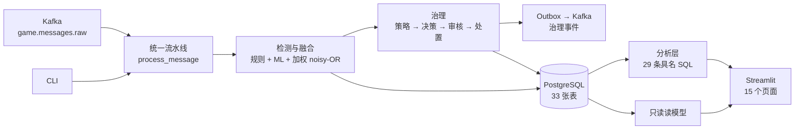

# Claro

**面向 SLG 游戏内聊天场景的内容安全与风险治理平台。**
Everything under control.

一条完整链路：消息入库 → 预处理 → 分层检测 → 风险融合 → 策略裁决 → 人工审核 → 模拟处置 → 反馈与审计 → 分析度量。全部跑在真实 PostgreSQL / Kafka / Redis 上，界面 15 个页面。


---

## 设计上坚持的四件事

| 原则 | 落地方式 |
|---|---|
| **判断可复现** | 同一消息 + 同一策略版本 + 同一检测结果，必然得到同一个 `decision_key` 与同一个动作；重跑不会产生第二条记录（`inbox_event` 幂等） |
| **数字可质疑** | 所有 KPI 只有一个口径来源；分母小于 30 的比率**拒绝发布**，界面显示"不可计算"与真实样本量 |
| **处置可追溯** | 每条消息可下钻：命中哪条规则、模型给多少分、哪次策略裁决、谁审核的、变更前后状态 |
| **不假装** | 未安装的 Hive 写"不可用"，缺模型写"无模型"，模拟处置标 `simulated=true` |

## 架构



分层：`ui/` → `application/` → `domain/` + `risk_engine/` + `governance/` → `data_access/` → `infrastructure/`。界面不含 SQL，读模型不含事务，风险引擎不依赖 Streamlit 或 SQLAlchemy。

## 能力

| 模块 | 实现要点 |
|---|---|
| 风险检测 | 22 条 YAML 规则 + char_wb TF-IDF / 逻辑回归 + 加权 noisy-OR 融合；语义层与 LLM 层默认关闭并显式标注不可用 |
| 策略中心 | 11 类策略、版本化与回滚、冲突扫描、Playground 试算 |
| 治理决策 | 确定性优先级、置信度降级、自动 / 人工分流 |
| 人工审核 | 状态机、乐观锁、二次复核、重开与反馈 |
| 模拟处置 | warn / block / mute / temp_ban / perm_ban，全部 `simulated=true`，到期与解除留痕 |
| 审计 | 追加式 `audit_event`，含变更前后状态、执行者、理由 |
| 分析层 | 29 条具名 SQL、单一口径版本、低样本门禁、6 张分析页、Markdown / CSV 报告导出 |
| 策略回放 | 基线 vs 候选逐样本比对，结果写入独立表，不影响业务表 |
| 事件链路 | Kafka 真实生产 / 消费 / 手动提交 / 重试 / DLQ，Outbox 兜底 |
| 缓存 | Redis 承担敏感词、策略、黑名单与原子限流；不可用时回落 PostgreSQL |
| 数据生成 | 固定 seed，默认 50,000 消息 / 5,000 玩家 / 10 服务器，全部标记为合成数据 |

## 快速开始

前提：Windows 11 + Python 3.12 + PostgreSQL 18 + Kafka 3.9 + Redis，原生安装，不使用 Docker / WSL。

```powershell
scripts\claro.ps1 install            # 建虚拟环境、装依赖
Copy-Item .env.example .env          # 按需填写 CLARO_DATABASE__URL 等
scripts\check_environment.ps1        # 六态自检，存在阻塞项时返回非零
scripts\start_claro.ps1              # 服务 → 迁移 → 应用，一键启动
scripts\run_demo.ps1                 # 14 步端到端演示
```

访问 <http://127.0.0.1:8501>，停止用 `scripts\stop_claro.ps1`。依赖、配置与脚本清单见 [docs/DEPLOYMENT_WINDOWS.md](docs/DEPLOYMENT_WINDOWS.md)。

## 实测数据

以下数字均来自本机实际运行，方法与分位数见 [docs/PHASE_06_PERFORMANCE.md](docs/PHASE_06_PERFORMANCE.md)。

| 项 | 值 |
|---|---|
| 消息 / 风险事件 / 原子证据 | 50,016 / 8,856 / 8,893 |
| 数据库表 / 具名 SQL / 页面 | 33 / 29 / 15（5 组导航） |
| 测试 | 308 passed，覆盖率 79% |
| 流水线吞吐（1k / 10k / 50k） | 67 / 62 / 78 行每秒 |
| 单条流水线 p50–p99 | 107–145 ms / 150–216 ms / 180–332 ms |

## 目录结构

```text
src/claro/
├── ui/               app.py（导航）、screens/（15 页）、theme.py、charts.py
├── application/      应用服务：process_message、explorer、demo、风险、治理、分析
├── domain/           枚举、值对象、状态机
├── risk_engine/      预处理、规则、ML、融合、评估
├── governance/       策略条件、决策降级、处置规则
├── analytics/        具名 SQL、指标、质量检查、报告
├── data_access/      SQLAlchemy 模型、仓储、只读读模型
├── infrastructure/   Kafka、Redis、日志（自动脱敏）
├── data_generation/  合成数据生成器、演示场景
└── config/           配置模型与校验
```

配套目录：`scripts/`（PowerShell 部署脚本）、`migrations/`（Alembic）、`config/`（风险分类、规则、阈值）、`deploy/`（Kafka / Redis 配置）、`docs/`、`tests/`。

## 测试

```powershell
scripts\run_tests.ps1 -Suite unit          # 无需外部服务
scripts\run_tests.ps1 -Suite integration   # 需要 PostgreSQL / Kafka / Redis
scripts\run_tests.ps1 -Suite ui            # 15 个页面逐个渲染
scripts\run_tests.ps1 -Suite all -Coverage
```

## 文档

| 文档 | 内容 |
|---|---|
| [ARCHITECTURE.md](docs/ARCHITECTURE.md) | 分层与关键决策 |
| [DATA_FLOW.md](docs/DATA_FLOW.md) | 消息到指标的完整路径、幂等设计 |
| [EVENT_FLOW.md](docs/EVENT_FLOW.md) | Kafka 拓扑、投递语义、失败处置、Outbox |
| [DATABASE_SCHEMA.md](docs/DATABASE_SCHEMA.md) | ER 图、约束与索引策略 |
| [RISK_INTELLIGENCE.md](docs/RISK_INTELLIGENCE.md) | 检测层、融合公式、阈值、模型资产 |
| [CONTENT_GOVERNANCE.md](docs/CONTENT_GOVERNANCE.md) | 策略、决策、审核状态机、处置、审计 |
| [ANALYTICS.md](docs/ANALYTICS.md) | 口径、低样本门禁、一致性检查、回放 |
| [KNOWN_LIMITATIONS.md](docs/KNOWN_LIMITATIONS.md) | 所有已知边界，逐条列明 |

## 数据与许可

仓库内数据全部为**合成数据**，由固定 seed 生成，不含真实玩家信息、真实聊天记录或真实运营指标。凭据不进入仓库：`.env` 已忽略，示例文件只含占位值。

MIT，见 [LICENSE](LICENSE)。
