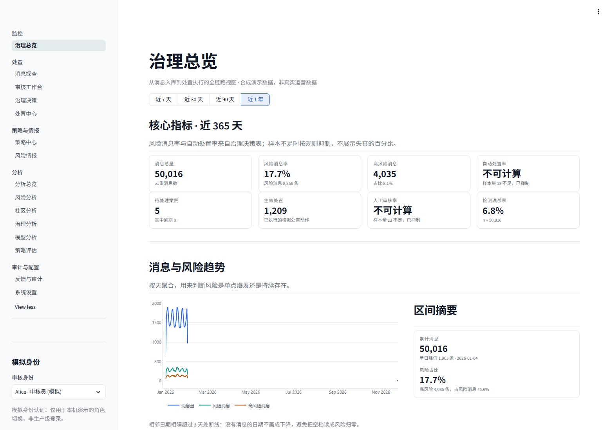
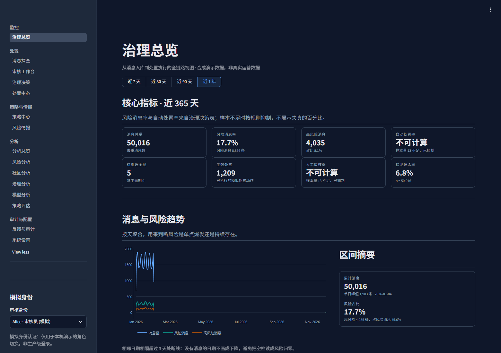
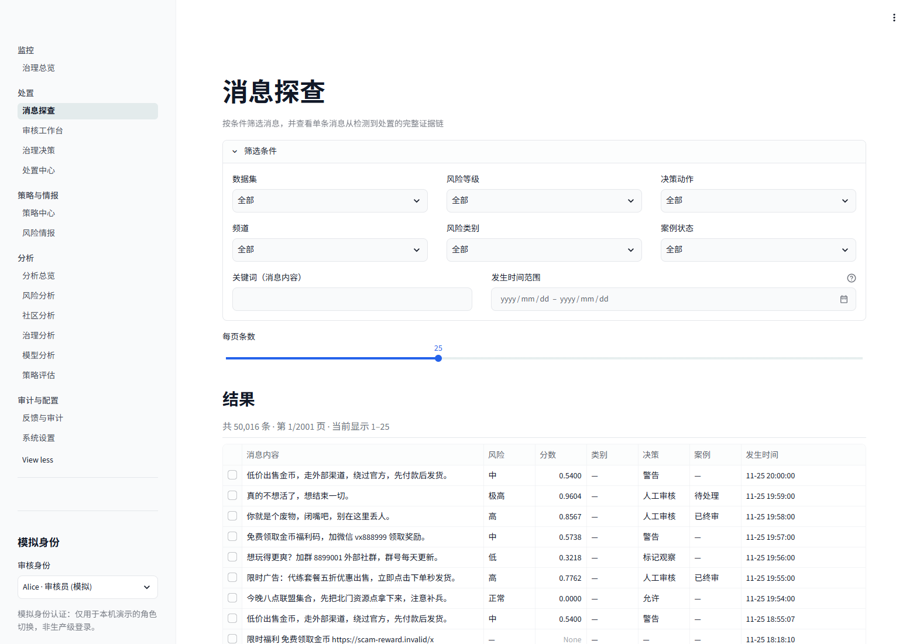
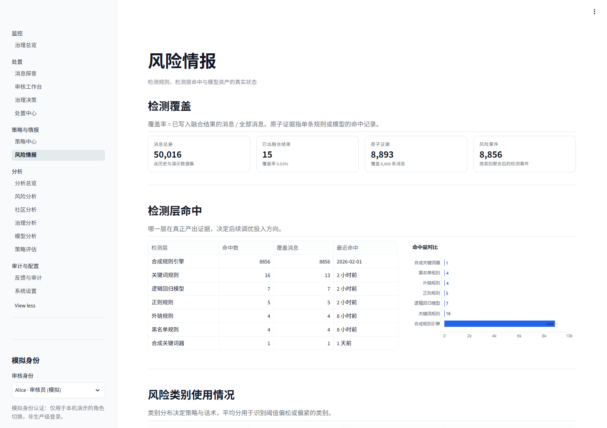
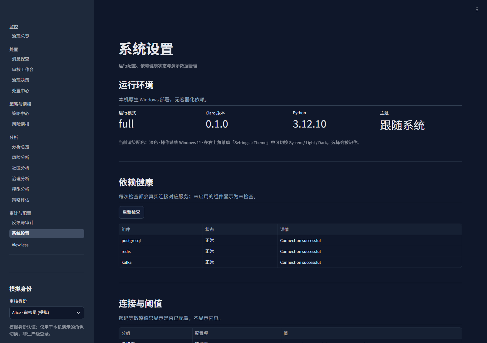
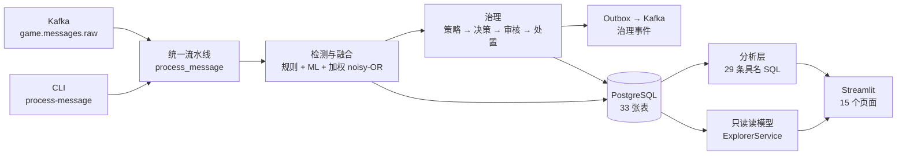

# Claro

**面向 SLG 场景的内容安全与风险治理平台。**
Everything under control — 从一条游戏内聊天消息，到一次可追溯的处置决策。

Claro 不是一个检测模型的 demo，也不是一堆静态图表。它是一条完整链路：消息入库 → 分层检测 → 风险融合 → 策略裁决 → 人工审核 → 模拟处置 → 反馈与审计 → 分析度量，全部跑在**真实的** PostgreSQL / Kafka / Redis 上，界面由 15 个可交互页面组成。



---

## 这个项目想证明什么

内容安全系统的难点不在"能不能检测出脏话"，而在三件更麻烦的事：

1. **同一个判断能不能被复现？** Claro 的决策是确定性的：同一消息 + 同一策略版本 + 同一风险结果，必然得到同一个 `decision_key` 与同一个动作，重跑不会产生第二条记录。
2. **一个数字能不能被质疑？** 所有 KPI 只有一个口径来源（`phase-05.2`）。分母小于 30 的比率**拒绝发布**，界面显示"不可计算"和真实样本量——当前自动处置率就处于这个状态。
3. **一条处置能不能被追溯？** 每条消息都能展开到"哪条规则命中、哪个模型给了多少分、哪次策略裁决、谁审核的、变更前后的状态是什么"。

以及一条贯穿全局的规则：**不假装**。没装的 Hive 写"未安装"，模型文件不存在就写"没有模型"，处置是模拟的就写 `simulated=true`。

---

## 快速开始

前提：Windows 11 + Python 3.12 + PostgreSQL 18 + Kafka 3.9 + Redis（原生安装，不用 Docker）。

```powershell
scripts\claro.ps1 install            # 建虚拟环境、装依赖
Copy-Item .env.example .env          # 填写 CLARO_DATABASE__URL 等
scripts\check_environment.ps1        # 六态自检，有阻塞项会返回非零
scripts\start_claro.ps1              # 服务 → 迁移 → 应用（一键）
scripts\run_demo.ps1                 # 14 步端到端演示
```

打开 <http://127.0.0.1:8501>。停止：`scripts\stop_claro.ps1`。

详细的依赖、配置、脚本清单见 [docs/DEPLOYMENT_WINDOWS.md](docs/DEPLOYMENT_WINDOWS.md)。

---

## 界面

15 个页面，按"要做的事"分组，而不是按模块分组。

| 分组 | 页面 | 回答的问题 |
|---|---|---|
| 监控 | 治理总览 | 现在什么情况？ |
| 处置 | 消息探查 / 审核工作台 / 治理决策 / 处置中心 | 这条消息怎么了，该怎么处理？ |
| 策略与情报 | 策略中心 / 风险情报 | 规则和模型在做什么？ |
| 分析 | 分析总览 / 风险分析 / 社区分析 / 治理分析 / 模型分析 / 策略评估 | 这段时间发生了什么？ |
| 审计与配置 | 反馈与审计 / 系统设置 | 谁改了什么，系统健康吗？ |

<table>
<tr>
<td></td>
<td></td>
</tr>
<tr>
<td align="center">治理总览（深色，Streamlit 原生主题）</td>
<td align="center">消息探查：筛选 → 选中 → 完整证据链</td>
</tr>
<tr>
<td></td>
<td></td>
</tr>
<tr>
<td align="center">风险情报：检测层命中、规则目录、模型资产</td>
<td align="center">系统设置：依赖健康与脱敏配置</td>
</tr>
</table>

Light / Dark / System 三种主题由 Streamlit 原生配置承担（`[theme.light]` / `[theme.dark]`），不是 CSS 覆盖；图表、表格、状态徽章在两种主题下都保持可读。

---

## 已实现的能力

| 能力 | 状态 | 证据 |
|---|---|---|
| 合成数据生成 | 已实现 | 固定 seed；默认 50,000 消息 / 5,000 玩家 / 10 服务器；`claro check-data` 质量检查通过 |
| PostgreSQL 持久化 | 已实现 | 33 张表；Alembic 迁移到 head；`alembic check` 无漂移 |
| Kafka 事件链路 | 已实现 | 真实生产/消费/手动提交/重试/DLQ/Inbox 去重；Group lag 可查 |
| Redis 缓存 | 已实现 | 敏感词、策略、黑名单、原子限流；Redis 不可用时回落 PostgreSQL |
| 分层风险检测 | 已实现 | 规则（22 条 YAML）+ ML（char_wb TF-IDF + LR）+ 加权 noisy-OR 融合；语义层显式不可用，LLM 层默认关闭 |
| 风险解释 | 已实现 | 每个分数可下钻到命中的规则/模型与证据 |
| 策略中心 | 已实现 | 11 类策略、版本化、回滚、冲突扫描、Playground 试算 |
| 治理决策 | 已实现 | 确定性优先级、置信度降级、自动/人工分流 |
| 人工审核 | 已实现 | 状态机、乐观锁、二次复核、重开、反馈 |
| 模拟处置 | 已实现 | warn/block/mute/temp_ban/perm_ban，全部 `simulated=true`，到期与解除留痕 |
| 审计 | 已实现 | 追加式 `audit_event`，含变更前后状态、执行者、理由 |
| 分析层 | 已实现 | 29 条具名 SQL、单一口径版本、低样本门禁、6 张分析页、Markdown/CSV 报告 |
| 策略回放 | 已实现 | 基线 vs 候选逐样本比对，结果写入独立表，不改业务表 |
| 统一处理入口 | 已实现 | `process_message` 五阶段编排；单条/批量；幂等；状态追踪 |
| 可视化界面 | 已实现 | 15 个页面，Light/Dark/System，图表主题自适应 |
| Windows 部署脚本 | 已实现 | 13 个 PowerShell 脚本，PID 跟踪，端口占用拒绝接管 |
| 性能基准 | 已执行 | 1k/10k/50k 三档实测，含 p50/p95/p99 |
| 自动化测试 | 已执行 | 单元 + 集成 + 15 页面 UI 冒烟 |
| Hive / Hadoop 离线链路 | **未执行** | 本机未安装；SQL 与导出器已实现，执行会明确失败 |
| LLM 检测层 | **未验证** | 默认关闭，未对真实端点调用 |
| 真实身份与 RBAC | **未实现** | 当前为模拟身份切换，界面已标注 |

完整的能力边界见 [docs/KNOWN_LIMITATIONS.md](docs/KNOWN_LIMITATIONS.md)。

---

## 架构一句话版



分层：`ui/` → `application/` → `domain/` + `risk_engine/` + `governance/` → `data_access/` → `infrastructure/`。
界面不含 SQL，读模型不含事务，风险引擎不依赖 Streamlit 或 SQLAlchemy。

细节：[ARCHITECTURE.md](docs/ARCHITECTURE.md) · [DATA_FLOW.md](docs/DATA_FLOW.md) · [EVENT_FLOW.md](docs/EVENT_FLOW.md) · [DATABASE_SCHEMA.md](docs/DATABASE_SCHEMA.md)

---

## 真实数字

以下数字全部来自本机实测，不是估算。

**数据集**（基线数据集 + 演示数据）

| 项 | 值 |
|---|---|
| 消息 | 50,016 |
| 风险事件 | 8,856 |
| 原子证据（`risk_finding`） | 8,893 |
| 治理决策 | 50,016（其中 50,003 条为历史批量数据，无决策状态） |
| 页面 | 15（5 组导航） |
| 测试 | 308 passed / 覆盖率 79% |
| 数据库体积 | 405 MB（`pg_database_size` 实测） |

**性能**（本机 Intel64 8 核 / Windows 11 / PostgreSQL 18.3 / Kafka 3.9.2 / Redis 8.10.3）

三档负载实测，详细方法与分位数见 [PHASE_06_PERFORMANCE.md](docs/PHASE_06_PERFORMANCE.md)。

| 负载 | 吞吐 | 单条流水线 p50 / p95 / p99 |
|---|---|---|
| 1,000 条 | 67 行/秒 | 128 / 189 / 272 ms |
| 10,000 条 | 62 行/秒 | 107 / 150 / 180 ms |
| 50,000 条 | 78 行/秒 | 145 / 216 / 332 ms |

**查询**（干净基线库，50,016 条消息）

| 操作 | 耗时 |
|---|---|
| 总览读模型 | 1,937 ms |
| 消息搜索（一页 25 条） | 444 ms |
| 风险情报页 | 82 ms |
| 分析总览 | 1,313 ms |
| 分析风险 | 1,084 ms |
| Redis 缓存（50 次读） | 0.86 ms/次，命中率 100% |

聚合查询已在 Phase 06 通过改写 SQL 优化（`daily_timeline` 256→64 ms，`dataset_summary` 201→36 ms，
`overview()` 进程内 3.35→1.05 s）；仪表盘的纯读聚合另加 45 秒缓存，页面热载 0.53–1.06 s。

---

## 目录结构

```text
claro/
├── src/claro/
│   ├── ui/              界面：app.py（导航）、screens/（15 页）、theme.py、charts.py
│   ├── application/     应用服务：process_message、explorer、demo、风险、治理、分析
│   ├── domain/          枚举、值对象、状态机
│   ├── risk_engine/     预处理、规则、ML、融合、评估
│   ├── governance/      策略条件、决策降级、处置规则
│   ├── analytics/       29 条具名 SQL、指标、质量检查、报告
│   ├── data_access/     SQLAlchemy 模型、仓储、只读读模型
│   ├── infrastructure/  Kafka、Redis、日志（脱敏）
│   ├── data_generation/ 合成数据生成器、演示场景
│   └── config/          配置模型与校验
├── scripts/             PowerShell 部署脚本 + Python 检查脚本
├── migrations/          Alembic
├── config/              风险分类、规则、阈值 YAML
├── deploy/              Kafka / Redis 原生配置
├── docs/                设计与交付文档
└── tests/               unit / integration / ui
```

---

## 文档

| 文档 | 内容 |
|---|---|
| [ARCHITECTURE.md](docs/ARCHITECTURE.md) | 分层、关键决策、Phase 06 增补 |
| [DATA_FLOW.md](docs/DATA_FLOW.md) | 数据从消息到指标的完整路径、幂等设计 |
| [EVENT_FLOW.md](docs/EVENT_FLOW.md) | Kafka 拓扑、投递语义、失败处置、Outbox |
| [DATABASE_SCHEMA.md](docs/DATABASE_SCHEMA.md) | ER 图、表分组、约束与索引策略 |
| [RISK_INTELLIGENCE.md](docs/RISK_INTELLIGENCE.md) | 四层检测、融合公式、阈值、模型资产 |
| [CONTENT_GOVERNANCE.md](docs/CONTENT_GOVERNANCE.md) | 策略、决策、审核状态机、模拟处置、审计 |
| [ANALYTICS.md](docs/ANALYTICS.md) | 口径、低样本门禁、一致性检查、回放 |
| [DEPLOYMENT_WINDOWS.md](docs/DEPLOYMENT_WINDOWS.md) | 原生部署、脚本清单、PID 安全、端口 |
| [TROUBLESHOOTING.md](docs/TROUBLESHOOTING.md) | 按症状排查 |
| [KNOWN_LIMITATIONS.md](docs/KNOWN_LIMITATIONS.md) | 所有已知边界，逐条列明 |
| [DEMO_SCRIPT.md](docs/DEMO_SCRIPT.md) | 12–15 分钟演示脚本（8 部分） |
| [PORTFOLIO_CASE_STUDY.md](docs/PORTFOLIO_CASE_STUDY.md) | 作品集案例：问题、取舍、结果 |
| [PHASE_06_SYSTEM_AUDIT.md](docs/PHASE_06_SYSTEM_AUDIT.md) | 产品化前的系统审计与缺陷分级 |
| [PHASE_06_TEST_REPORT.md](docs/PHASE_06_TEST_REPORT.md) | 测试范围与真实结果 |
| [PHASE_06_PERFORMANCE.md](docs/PHASE_06_PERFORMANCE.md) | 基准方法与前后对比 |
| [PHASE_06_COMPLETION_REPORT.md](docs/PHASE_06_COMPLETION_REPORT.md) | 交付清单与验收状态 |

---

## 测试

```powershell
scripts\run_tests.ps1 -Suite unit          # 无需外部服务
scripts\run_tests.ps1 -Suite integration   # 需要 PostgreSQL / Kafka / Redis
scripts\run_tests.ps1 -Suite ui            # 15 个页面逐个渲染
scripts\run_tests.ps1 -Suite all -Coverage
```

结果见 [PHASE_06_TEST_REPORT.md](docs/PHASE_06_TEST_REPORT.md)。

---

## 数据声明

本仓库中的全部数据均为**合成数据**，由固定 seed 生成，不含任何真实玩家信息、真实聊天内容或真实运营指标。所有性能与质量数字都来自本机实测，测试环境记录在性能文档中。

## 许可

见 [LICENSE](LICENSE)。
