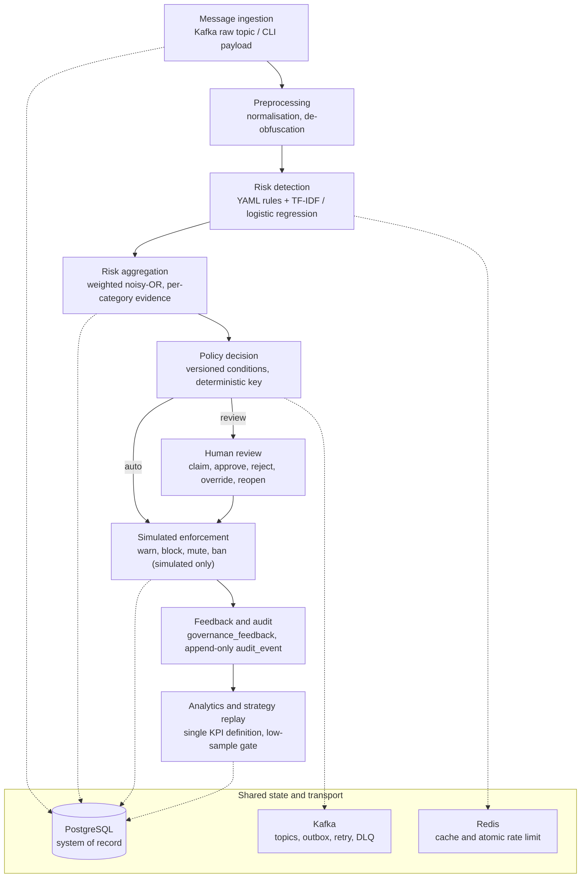

# Claro

[简体中文](README.zh-CN.md)

A local-first engineering prototype for content safety and risk governance in SLG (strategy game) player chat.

Claro runs a governance lifecycle over synthetic chat messages, from ingestion through analytics. Every message keeps a stage-by-stage processing history.

Built with Python 3.12, PostgreSQL, Kafka, Redis, scikit-learn and Streamlit, it runs as native Windows 11 processes — no Docker, Docker Compose or WSL.

**Status:** an engineering prototype, not a production-validated moderation system. All data comes from fixed-seed synthetic templates; there is no game server connection, no real player punishment, and some detection layers are unavailable ([Limitations](#limitations)).

## Overview

Player chat in an SLG is organised around alliances and servers. Abuse tends to arrive as a bundle — off-platform contact, fake reward lures, account trading, coordinated harassment — spread across channels and repeated by the same accounts. A moderation team therefore faces three questions that a text classifier does not answer: should this message be handled automatically or seen by a person; what exactly was observed if the decision turns out to be wrong; and whether last month's policy is still appropriate.

A label by itself produces no decision. A decision has to carry the evidence behind it, the policy version that selected it, the confidence that allowed or prevented automatic action, and the identity of the person who changed it. It also has to survive replay: given the same message, the same policy version and the same detection result, the outcome must be identical.

SLG chat was chosen because it supplies the context a standalone text dataset does not: player identity, server, alliance, channel, repeat-offence history and time windows. Those fields are what make a declarative policy, a rate limit, a review queue and a strategy comparison meaningful.

Claro separates "how risky is this message" from "what do we do about it". `risk_engine/` produces a fused score and per-category evidence; `governance/` turns it into a decision. Case state, simulated enforcement, feedback, audit rows and KPIs all key back to that decision and to the original `trace_id`.

## How it works



`ClaroProcessingService.process_message()` runs `validate → ingest → detect → publish → governance` in one call; the Kafka consumer calls the same downstream services. Each stage records its status and elapsed time in `processing_event`; one `trace_id` links the message to its risk result, decision, case, enforcement and audit rows. The UI reads through read-only repositories: it issues no SQL and holds no transaction.

## Engineering decisions

### Detection and decision are separate stages

`risk_engine/` has no dependency on Streamlit or SQLAlchemy and never decides enforcement. Independent detectors emit `Finding` objects; fusion returns a score, per-category contributions, a confidence value, a suggested action and a `fusion_trace`. `governance/` re-evaluates that result against the active policy set. Risk cutoffs (`config/risk_thresholds.yaml`) and governance confidence thresholds (`DecisionThresholds`) are two separate configurations.

The same detection result can be replayed against a different policy version without re-running detection. The cost is two threshold sets that must stay coherent, and an explanation that requires the policy snapshot and matched conditions in addition to the score.

### Rules, a small model, and explicit fusion

22 YAML rules cover keyword, regex, URL, blacklist and repetition patterns, each match carrying evidence spans. A `char_wb` TF-IDF + one-vs-rest logistic regression model adds a second layer. Fusion groups contributions by category and applies `1 - Π(1 - w_layer × strength)`, taking the maximum category score as the overall score. Layer weights (rule 0.90, ml 0.80, semantic 0.60, llm 0.50), severity scores and the 0.50 ML probability floor live in `config/risk_thresholds.yaml`. Rule/ML disagreements are persisted as `Conflict` entries rather than averaged away.

Rules can be quoted in an audit trail; the model covers surface variation. Noisy-OR preserves multiple weak signals and keeps the output multi-label. The weights are hand-tuned, not statistically calibrated. A missing layer contributes no findings; the detection metadata records the semantic layer as `not_available`, the LLM layer as `disabled` when it is off, and a `degraded_reason` when the model cannot be loaded. Weights are not redistributed.

### At-least-once delivery, three idempotency keys, an outbox and a DLQ

The producer uses `acks=all` with idempotent production. The consumer disables auto-commit and commits an offset only after the database transaction, or retry/DLQ routing, succeeds. Three keys absorb replays: `inbox_event` (event id, `(topic, partition, offset)` and a content-addressed payload hash), the unique `risk_result.message_id`, and the deterministic decision key. Governance events are appended to `outbox_event` inside the same transaction as the business rows and published later by `OutboxDispatcher`; exhausted attempts land in the dead-letter path.

This removes the need for a distributed transaction between PostgreSQL and Kafka. The payload hash deliberately excludes the send timestamp — including it made replayed messages look like different payloads and broke idempotency. A failed publish does not roll back an already committed risk result; `process_message()` marks that stage failed and returns `partial`.

### Deterministic decisions and versioned policies

Policy conditions are structured JSON over a field/operator whitelist. `governance/policy.py` rejects unknown fields, caps nesting depth and node count, and forbids lookarounds and backreferences in policy regexes; there is no `eval`. Versions are immutable snapshots with a SHA-256 hash, an effective window and a change reason. Selection is ordered by emergency flag, priority, scope specificity, action restrictiveness and key, so ties cannot produce different outcomes; conflicts are reported. `decide_governance_action()` downgrades a restrictive action to `review` when confidence is below 0.55, and does the same for high/critical risk below 0.70.

A decision that can be recomputed can be audited, replayed and diffed. Most policies in the bulk dataset have only `v1`, so cross-version comparison has little material — the demo dataset creates a second version. Replay is a same-input, two-policy comparison at evaluation time, not a reconstruction of the policy that was active when a historical message was sent.

### A moderation state machine and enforcement that stays simulated

`CASE_TRANSITIONS` defines claim → in_review → approved / rejected / escalated / second_review → finalized, with a reopen path. An override requires both `final_action` and `final_level`; `reject` resolves to `allow`, so blocking has to be an explicit override. `plan_enforcement()` builds a plan with `simulated=True` and validates the action, target and duration. `execute_enforcement()` then checks that the action matches the decision or the reviewed final action before `EnforcementService` writes local `enforcement_action` and `player_enforcement_state` rows with `simulated=true`; expiry and release have their own records. An append-only `audit_event` stores before/after state, actor, reason and trace id.

The trade-off is no ticket-system or game-server integration and no SLA escalation.

### One KPI definition and a low-sample gate

`analytics/definitions.py` holds the canonical formula identifiers under version `phase-05.2` plus a hash of the formula set; services, pages, reports and CSV exports call the same functions. `gated_rate()` returns `None`, `low_sample=True` and the real sample size when the denominator is below 30. `StrategyReplayService` re-evaluates unchanged historical messages against a baseline and a candidate policy set in memory and writes only to `analytics_replay_*` tables; it never calls enforcement and never modifies a formal decision.

A second formula implementation would silently produce two different answers. The cost is that dashboards frequently show "not computable" on this dataset, replay results below 100 samples are flagged exploratory, and rate-limit policies are replayed with `rate_count=0` so they do not reproduce live behaviour.

## Features

| Area | What is implemented |
| --- | --- |
| Ingestion and data | Fixed-seed synthetic generator (players, servers, alliances, messages, labels); Kafka raw topic and CLI payloads; `inbox_event` deduplication; per-stage `processing_event` trace with a shared `trace_id`. |
| Risk intelligence | YAML rule engine with span evidence; TF-IDF / logistic-regression detector; weighted noisy-OR fusion with per-category contributions and conflicts; persisted `risk_result`, `risk_finding` and fusion trace; evaluation runs and error cases. |
| Policy centre | Versioned declarative policies, immutable snapshots, conflict scan, enable/disable, rollback and a playground evaluation. |
| Decision and moderation | Deterministic decision keys, confidence-based downgrade, automatic/review routing, review queue, claim / approve / reject / override / escalate / second review / reopen, and optimistic locking. |
| Enforcement and audit | warn, block, mute, temp_ban and perm_ban recorded locally as simulated; expiry and release; feedback classification; append-only audit events with before/after state. |
| Analytics | One KPI definition version, low-sample suppression, three consistency checks, Markdown and CSV reports, and isolated strategy replay. |
| Operations UI | Screens in five navigation groups; light, dark and system themes through native Streamlit configuration; token-driven Plotly charts; a 45-second read cache with a manual refresh. |
| Infrastructure | Kafka retry / DLQ / outbox dispatcher, Redis caching and Lua atomic rate limiting with a PostgreSQL fallback, Alembic migrations, redacted structured logging, health checks and PID-safe service scripts. |

## Screenshots

Captures from the running application (`tests/ui/browser_smoke.py --screenshots`, real Chrome). UI copy is predominantly Chinese.

**Overview** — KPI cards, message/risk trends and the low-sample notice.


**Message Explorer** — filters and the result list that opens a message's evidence chain.


**Analytics overview, dark theme** — the KPI definition banner and an explicit explanation of why two rates are suppressed.


All 15 screens in both themes are in [docs/screenshots/](docs/screenshots/).

## Tech stack

| Technology | Used for | Where |
| --- | --- | --- |
| Python 3.12 | application, domain, risk engine, analytics | `src/claro/` |
| PostgreSQL 18, SQLAlchemy 2, Alembic | system of record, transactions, migrations | `data_access/`, `migrations/` |
| Apache Kafka 3.9 (KRaft, `confluent-kafka`) | content and governance events, retry / DLQ, outbox | `infrastructure/kafka.py`, `application/outbox_dispatcher.py` |
| Redis (`redis-py`) | rule / policy / blacklist cache, Lua atomic rate limit | `infrastructure/redis.py` |
| scikit-learn, joblib | `char_wb` TF-IDF + one-vs-rest logistic regression | `risk_engine/ml/`, `models/` |
| pandas, NumPy | synthetic data generation, analytics frames | `data_generation/`, `analytics/` |
| Streamlit, Plotly | operations UI and token-driven charts | `ui/` |
| pydantic, pydantic-settings, PyYAML | configuration validation, rules, taxonomy, thresholds | `config/`, `config/*.yaml` |
| structlog | structured JSON logging with sensitive-field redaction | `infrastructure/logging.py` |
| pytest, Streamlit AppTest | unit, integration and UI smoke tests | `tests/`, `scripts/run_tests.ps1` |
| PowerShell 5.1 | native service orchestration | `scripts/` |

## Getting started

Run everything from the repository root in PowerShell 5.1 on Windows 11.

### Prerequisites

| Component | Requirement |
| --- | --- |
| Python | 3.12, with the `py -3.12` launcher available |
| PostgreSQL | 18 as a Windows service (default `postgresql-x64-18`); `scripts\init_database.ps1` creates the database and role. The password belongs in `%APPDATA%\postgresql\pgpass.conf`, not in `.env`. |
| Java | JDK 17, for example `winget install Microsoft.OpenJDK.17` |
| Kafka | Apache Kafka 3.9.x (KRaft) unpacked under `runtime/kafka/` as a `kafka_2.*-*` directory; the launcher resolves it from there and uses `deploy/kafka/server.properties` |
| Redis | Windows fork, for example `winget install taizod1024.redis-windows-fork`; config in `deploy/redis/redis.conf` |
| Ports | 5432, 9092, 9093, 6379 and 8501 free; all bind to loopback by default |

The scripts refuse to take over a port owned by another process and stop only processes whose PID file and command line match.

### Install and run

```powershell
# 1. Create .venv, install the package with dev extras, and create .env
#    from .env.full.example (an existing .env is never overwritten).
scripts\claro.ps1 install -Full

# 2. Review CLARO_DATABASE__URL and the other settings in .env.
#    Keep the PostgreSQL password in %APPDATA%\postgresql\pgpass.conf.
notepad .env

# 3. Create the database and role (idempotent).
scripts\init_database.ps1

# 4. Six-state prerequisite check; exits 1 on Missing / Incompatible.
scripts\check_environment.ps1

# 5. Environment check -> services -> migrations to head -> Streamlit.
scripts\start_claro.ps1
```

Open <http://127.0.0.1:8501>. `scripts\stop_claro.ps1` stops the app, consumer, Kafka and Redis in reverse order; PostgreSQL stays running by default.

Configuration precedence is environment variables > `.env` > `config/*.yaml`. Nested keys use double underscores (`CLARO_DATABASE__URL`), unknown `CLARO_*` variables fail startup, and `full` mode rejects SQLite and placeholder passwords. Details: [docs/DEPLOYMENT_WINDOWS.md](docs/DEPLOYMENT_WINDOWS.md).

### Load data

```powershell
scripts\generate_demo_data.ps1    # 5,000 synthetic background messages
scripts\run_demo.ps1              # 14-step walkthrough; a second run reports "duplicate"
scripts\run_demo.ps1 -Status      # inspect the demo dataset
```

For the full baseline (50,000 messages, 5,000 players, 10 servers, 500 alliances, seed 20261125):

```powershell
scripts\generate_data.ps1 -Load
```

This is a row-by-row transactional load and takes time on a single machine; the bottleneck is documented in [docs/PHASE_06_PERFORMANCE.md](docs/PHASE_06_PERFORMANCE.md).

### Development mode and tests

`scripts\claro.ps1 install` without `-Full` writes `.env` from `.env.example` with `CLARO_APP__MODE=development`, which uses an in-memory event bus and needs no external services. Unit tests run in that mode:

```powershell
scripts\run_tests.ps1 -Suite unit
scripts\run_tests.ps1 -Suite all -Coverage   # needs PostgreSQL, Kafka and Redis running
```

Integration tests connect to real services; they are not mocked. `-Suite all` explicitly overrides the default `not integration` marker in `pyproject.toml`.

## Project structure

```text
src/claro/
├── ui/                 app.py (st.navigation), screens/, theme.py, charts.py, cache.py
├── application/         processing_service.py, risk/governance services, outbox_dispatcher.py
├── domain/              enums, message and safety value objects
├── risk_engine/         preprocessing, rules, ML, fusion, explainability, evaluation
├── governance/          policy conditions, decision downgrade, moderation, enforcement plan
├── analytics/           KPI definitions, named SQL, metrics, quality, reports, replay
├── data_access/         SQLAlchemy models, repositories, read-only explorer repository
├── infrastructure/      Kafka, Redis, in-memory bus, logging, health
├── data_generation/     fixed-seed generator, demo scenarios
└── config/              pydantic settings

config/         detection rules, taxonomy, fusion thresholds, mode YAML
migrations/     Alembic revisions
scripts/        PowerShell install / start / stop / test / demo / benchmark
deploy/         native Kafka, Redis and PostgreSQL bootstrap configuration
models/         one committed baseline ML artifact and its metadata
docs/           architecture, decision records, phase reports, screenshots
tests/          unit, integration (real services), UI smoke
```

Page modules live in `ui/screens/`, not `ui/pages/`: the latter name triggers Streamlit's own multipage router and conflicts with the explicit navigation.

## Verification

The last recorded full run in [docs/PHASE_06_TEST_REPORT.md](docs/PHASE_06_TEST_REPORT.md) is **308 passed, 0 failed, 79% statement coverage** from a single execution of `scripts\run_tests.ps1 -Suite all -Coverage` (240 unit / 51 integration / 17 UI smoke). Conditions: Windows 11 build 26340, Python 3.12.10, PostgreSQL 18.3, Kafka 3.9.2 KRaft, Redis 8.10.3 (Phase 06 verification run). `scripts\check_reliability.py` reported 7/7 checks passing in the same phase. A separate manual Chrome inspection (`tests/ui/browser_smoke.py`) covers 15 screens in light and dark and is not part of the pytest run.

Performance was measured twice on that machine, with results differing by roughly 20%; no throughput or latency figure is quoted here. [docs/PHASE_06_PERFORMANCE.md](docs/PHASE_06_PERFORMANCE.md) records both runs, the method, the environment and the three SQL rewrites that were kept after before/after measurement. No concurrent test was run.

## Limitations

**Data and scope**

- Every record is synthetic (`synthetic=true`), generated from a fixed seed and a limited template set. There are no real player identities, chat logs or operational metrics, and the KPIs validate the pipeline rather than any online effect.
- No game server is connected. warn, block, mute, temp_ban and perm_ban are written to local tables with `simulated=true`; nothing is enforced on a player account.
- The historical bulk rows were produced by a synthetic rule engine, not by the full detection pipeline. Only a small number of messages carry a complete fused `risk_result` with rule, ML and fusion evidence; coverage figures and KPI denominators reflect that.

**Detection**

- Semantic detection is not implemented. `UnavailableSemanticDetector` returns `None`, and the detection metadata records the layer as `not_available`.
- The LLM advisor is a real HTTP adapter but is disabled by default, has only been tested against a fake transport, has never been called against a credentialed endpoint, and never produces an enforcement decision.
- The ML model was trained on synthetic templates. Test micro/macro F1 is 1.0, but 99.47% of test messages share content hashes with the training set; the 27-message content-disjoint subset contains no risk samples and yields F1 0.0. These metrics show that training, serialisation, inference and evaluation run correctly. They do not establish accuracy on real chat. See [docs/MODEL_EVALUATION.md](docs/MODEL_EVALUATION.md) and [models/README.md](models/README.md).
- The category taxonomy is fixed in YAML; adding a category means editing config and retraining. There is no online learning and no ReDoS complexity analysis for rule regexes.

**Infrastructure**

- Hive / Hadoop / Beeline are not installed. ODS → DWD → DWS → ADS SQL and the CSV exporter exist, but the executor fails explicitly instead of reporting success; PostgreSQL serves the same metrics.
- Single-node Kafka (replication factor 1), a single PostgreSQL instance and a single Redis instance. No HA, TLS, ACLs, streaming replication or failover rehearsal.
- Identity is simulated: the sidebar role is written into audit rows but is not used for authorisation. There is no login, session handling, RBAC or API gateway.
- `audit_event` is append-only at the application layer, with no chained hashes or external anchoring.
- Benchmarks are single-process and single-machine; browser rendering, TLS, proxies and concurrency are excluded.
- There is no CI pipeline; tests run locally through `scripts\run_tests.ps1`. Alembic `downgrade()` exists but has not been rehearsed against a populated database.

**Product surface**

- The UI is mostly Chinese, laid out for desktop widths, with no mobile adaptation or internationalisation. A few headings remain in English.
- Read-only dashboard aggregates are cached for 45 seconds, so numbers can lag; write paths are never cached.
- Moderation write paths (claim, override, enforcement) were verified manually in a browser, not by automated click-then-database assertions. `cli.py` has limited direct coverage.
- Report export is Markdown and CSV only; Excel and PDF are not implemented.
- Most bulk policies have only `v1`, automatic-handling and manual-review rates are often suppressed by the low-sample gate, and the first uncached dashboard load takes several seconds.

The complete list is in [docs/KNOWN_LIMITATIONS.md](docs/KNOWN_LIMITATIONS.md).

## Documentation

| Topic | Documents |
| --- | --- |
| Architecture | [ARCHITECTURE.md](docs/ARCHITECTURE.md), [DATA_FLOW.md](docs/DATA_FLOW.md), [EVENT_FLOW.md](docs/EVENT_FLOW.md), [DATABASE_SCHEMA.md](docs/DATABASE_SCHEMA.md) |
| Risk and model | [RISK_INTELLIGENCE.md](docs/RISK_INTELLIGENCE.md), [MODEL_EVALUATION.md](docs/MODEL_EVALUATION.md), [models/README.md](models/README.md) |
| Governance | [CONTENT_GOVERNANCE.md](docs/CONTENT_GOVERNANCE.md), [POLICY_ENGINE.md](docs/POLICY_ENGINE.md), [MODERATION_WORKFLOW.md](docs/MODERATION_WORKFLOW.md), [ENFORCEMENT_SIMULATOR.md](docs/ENFORCEMENT_SIMULATOR.md) |
| Analytics | [ANALYTICS.md](docs/ANALYTICS.md), [KPI_DEFINITIONS.md](docs/KPI_DEFINITIONS.md), [STRATEGY_EVALUATION.md](docs/STRATEGY_EVALUATION.md) |
| Operations | [DEPLOYMENT_WINDOWS.md](docs/DEPLOYMENT_WINDOWS.md), [TROUBLESHOOTING.md](docs/TROUBLESHOOTING.md), [DEMO_SCRIPT.md](docs/DEMO_SCRIPT.md) |
| Phase 06 records | [SYSTEM_AUDIT](docs/PHASE_06_SYSTEM_AUDIT.md), [COMPLETION_REPORT](docs/PHASE_06_COMPLETION_REPORT.md), [PERFORMANCE](docs/PHASE_06_PERFORMANCE.md), [TEST_REPORT](docs/PHASE_06_TEST_REPORT.md) |
| Boundaries and case study | [KNOWN_LIMITATIONS.md](docs/KNOWN_LIMITATIONS.md), [PORTFOLIO_CASE_STUDY.md](docs/PORTFOLIO_CASE_STUDY.md) |

## License

MIT. See [LICENSE](LICENSE). Copyright (c) 2026 李鹏飞.
