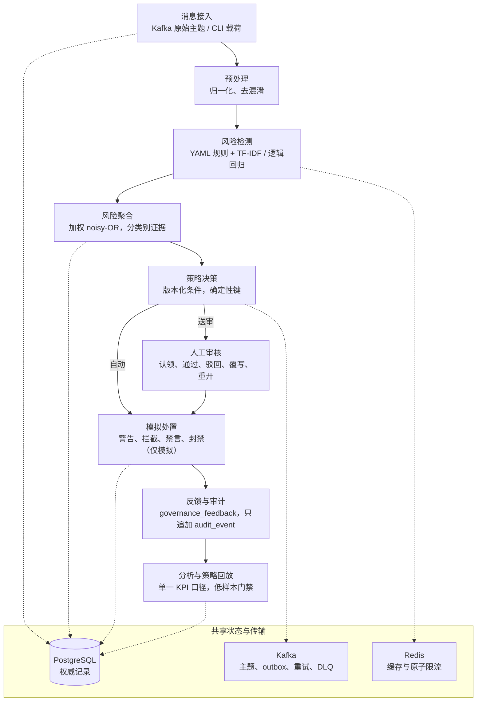
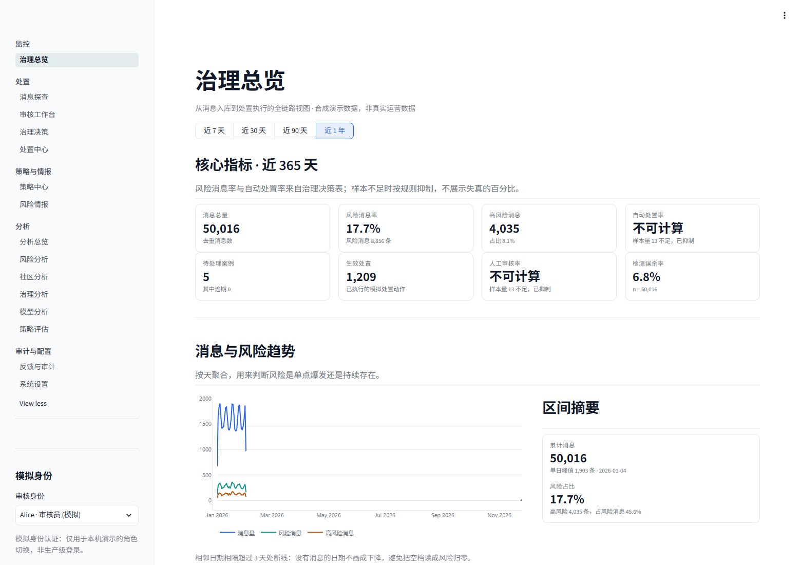
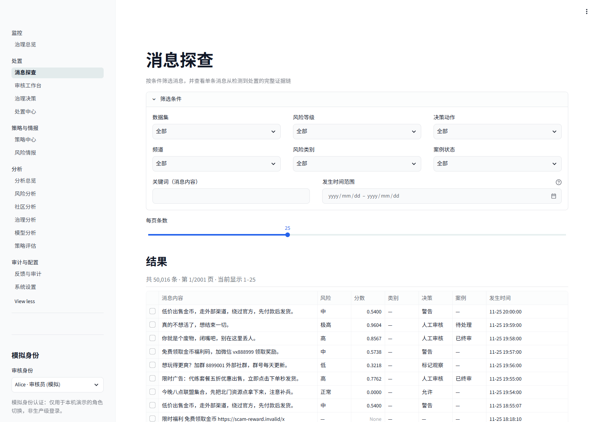
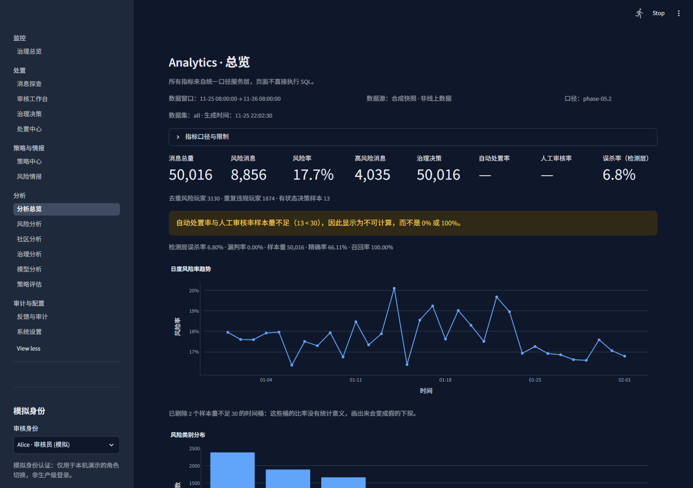

# Claro

[English](README.md)

面向 SLG（策略游戏）玩家聊天的内容安全与风险治理系统，本地运行的工程原型。

Claro 对合成聊天消息跑完从接入到分析的治理流程。每条消息保留逐阶段的处理记录。

用 Python 3.12、PostgreSQL、Kafka、Redis、scikit-learn 和 Streamlit 构建，在 Windows 11 上以原生进程运行 —— 不使用 Docker、Docker Compose 或 WSL。

**状态**：工程原型，不是经过线上验证的审核系统。所有数据来自固定种子的合成模板；不连接游戏服务器，不产生真实玩家处罚，部分检测层不可用（见[限制](#限制)）。

## 概览

SLG 的玩家聊天围绕联盟和服务器组织。违规内容往往成捆出现 —— 站外联系方式、虚假奖励诱导、账号交易、有组织的骚扰 —— 分散在多个频道，由同一批账号反复发送。审核团队要回答三个文本分类器回答不了的问题：这条消息该自动处理还是交给人看；如果事后证明决策错了，当时究竟观测到了什么；上个月的策略现在是否仍然合适。

一个标签本身不构成决策。决策必须带上支撑它的证据、选中它的策略版本、决定能否自动处置的置信度，以及修改它的人。它还必须经得起重放：同一条消息、同一个策略版本、同一份检测结果，必须得到完全相同的结果。

选 SLG 聊天，是因为它提供了纯文本数据集没有的上下文：玩家身份、服务器、联盟、频道、重复违规历史和时间窗口。正是这些字段让声明式策略、限流、审核队列和策略对比有意义。

Claro 把「这条消息有多危险」和「该拿它怎么办」分开。`risk_engine/` 给出融合分数和分类别证据；`governance/` 把它变成决策。工单状态、模拟处置、反馈、审计记录和 KPI 都回指这个决策以及最初的 `trace_id`。

## 工作方式



`ClaroProcessingService.process_message()` 一次调用内按 `validate → ingest → detect → publish → governance` 执行；Kafka 消费者调用同一组下游服务。每个阶段把状态和耗时写入 `processing_event`；一个 `trace_id` 把消息与它的风险结果、决策、工单、处置、审计记录串起来。UI 通过只读仓储读取数据：不执行 SQL，也不持有事务。

## 工程设计

### 检测与决策分成两个阶段

`risk_engine/` 不依赖 Streamlit 或 SQLAlchemy，也从不决定处置动作。各检测器独立产出 `Finding` 对象；融合层返回分数、分类别贡献、置信度、建议动作和 `fusion_trace`。`governance/` 再用当前生效的策略集重新评估这个结果。风险阈值（`config/risk_thresholds.yaml`）和治理置信度阈值（`DecisionThresholds`）是两套独立配置。

同一份检测结果可以换一个策略版本重放，不必重跑检测。代价是两套阈值必须保持一致，而且解释一个决策时，除了分数还要给出策略快照和命中的条件。

### 规则、小模型和显式融合

22 条 YAML 规则覆盖关键词、正则、URL、黑名单和重复模式，每次命中都带证据片段。`char_wb` TF-IDF + one-vs-rest 逻辑回归模型构成第二层。融合把贡献按类别分组，套用 `1 - Π(1 - w_layer × strength)`，取各类别的最高分作为总分。层权重（规则 0.90、ML 0.80、语义 0.60、LLM 0.50）、严重度分数和 0.50 的 ML 概率下限都放在 `config/risk_thresholds.yaml`。规则与 ML 不一致时记为 `Conflict`，不做平均抹平。

规则可以在审计里逐条引用，模型负责覆盖表面变体。noisy-OR 保留多个弱信号，输出仍是多标签。权重是手工调的，没有做统计校准。缺失的层不贡献结果；检测元数据会把语义层记为 `not_available`、关闭时的 LLM 层记为 `disabled`，模型加载失败时写 `degraded_reason`。权重不会重新分配。

### 至少一次投递、三把幂等键、outbox 与 DLQ

生产者使用 `acks=all` 和幂等生产。消费者关闭自动提交，只有在数据库事务、或重试/DLQ 路由成功之后才提交 offset。三把键吸收重放：`inbox_event`（事件 id、`(topic, partition, offset)` 和按内容寻址的载荷哈希）、唯一的 `risk_result.message_id`、确定性的决策键。治理事件和业务行在同一个事务里写入 `outbox_event`，之后由 `OutboxDispatcher` 发布；重试耗尽的进入死信路径。

这样就不必在 PostgreSQL 和 Kafka 之间做分布式事务。载荷哈希特意排除了发送时间戳 —— 一旦把它算进去，重放的消息会被当成不同载荷，幂等就失效了。发布失败不会回滚已提交的风险结果；`process_message()` 把该阶段标记为失败并返回 `partial`。

### 确定性决策与版本化策略

策略条件是结构化 JSON，字段和运算符走白名单。`governance/policy.py` 拒绝未知字段，限制嵌套深度和节点数，禁止策略正则里的前后查找和反向引用；没有 `eval`。版本是不可变快照，带 SHA-256 哈希、生效窗口和变更原因。选取顺序按紧急标记、优先级、作用域精确度、动作限制程度和键排序，因此并列时不会得出不同结果；冲突会被报出。置信度低于 0.55 时，`decide_governance_action()` 把限制性动作降级为 `review`；高风险/危急风险在置信度低于 0.70 时同样降级。

能重算的决策才能审计、重放和比对差异。批量数据集里多数策略只有 `v1`，跨版本对比几乎没有材料 —— 演示数据集会创建第二个版本。回放是在评估时用同一批输入比较两套策略，不是重建某条历史消息发送时生效的策略。

### 审核状态机与始终模拟的处置

`CASE_TRANSITIONS` 定义了认领 → 审核中 → 通过 / 驳回 / 升级 / 二次审核 → 结案，以及一条重开路径。覆写必须同时给出 `final_action` 和 `final_level`；`reject` 归到 `allow`，所以拦截必须是显式覆写。`plan_enforcement()` 生成 `simulated=True` 的计划，并校验动作、目标和时长。`execute_enforcement()` 在写入前再校验动作与决策或审核后的最终动作一致，之后 `EnforcementService` 把 `simulated=true` 的 `enforcement_action` 和 `player_enforcement_state` 写到本地表；到期和解除各有自己的记录。只追加的 `audit_event` 保存前后状态、操作者、原因和 trace id。

代价是没有工单系统或游戏服务器集成，也没有 SLA 升级机制。

### 单一 KPI 口径与低样本门禁

`analytics/definitions.py` 保存 `phase-05.2` 版本下的规范公式标识和公式集哈希；服务、页面、报告和 CSV 导出都调用同一组函数。分母小于 30 时，`gated_rate()` 返回 `None`、`low_sample=True` 和真实样本量。`StrategyReplayService` 在内存里用基线和候选策略集重新评估未改动的历史消息，只写 `analytics_replay_*` 表；它不调用处置，也不修改正式决策。

再写一份公式实现，就会悄悄得到两个不同答案。代价是这份数据集上仪表盘经常显示「不可计算」，样本不足 100 的回放结果标记为探索性，限流策略回放时用 `rate_count=0`，因此不会复现线上行为。

## 已实现功能

| 模块 | 已实现内容 |
| --- | --- |
| 接入与数据 | 固定种子的合成数据生成器（玩家、服务器、联盟、消息、标签）；Kafka 原始主题与 CLI 载荷；`inbox_event` 去重；逐阶段 `processing_event` 记录，共用 `trace_id`。 |
| 风险识别 | 带证据片段的 YAML 规则引擎；TF-IDF / 逻辑回归检测器；加权 noisy-OR 融合，含分类别贡献与冲突；持久化的 `risk_result`、`risk_finding` 与融合轨迹；评估运行与错误样本。 |
| 策略中心 | 版本化声明式策略、不可变快照、冲突扫描、启停、回滚和策略试验场评估。 |
| 决策与审核 | 确定性决策键、按置信度降级、自动/送审路由、审核队列、认领 / 通过 / 驳回 / 覆写 / 升级 / 二次审核 / 重开，以及乐观锁。 |
| 处置与审计 | 警告、拦截、禁言、临时封禁、永久封禁，均以模拟状态记入本地表；到期与解除；反馈分类；只追加的审计事件，含前后状态。 |
| 分析 | 单一 KPI 口径版本、低样本抑制、三项一致性检查、Markdown 与 CSV 报告、隔离的策略回放。 |
| 运营界面 | 五个导航组下的页面；通过 Streamlit 原生配置支持浅色、深色和跟随系统主题；token 驱动的 Plotly 图表；45 秒只读缓存与手动刷新。 |
| 基础设施 | Kafka 重试 / DLQ / outbox 分发器，Redis 缓存与 Lua 原子限流（PostgreSQL 兜底），Alembic 迁移，脱敏结构化日志，健康检查与 PID 安全的服务脚本。 |

## 界面截图

来自运行中的真实应用（`tests/ui/browser_smoke.py --screenshots`，真实 Chrome）。界面文案以中文为主。

**总览** —— KPI 卡片、消息/风险趋势与低样本提示。



**消息检索** —— 筛选条件与结果列表，可打开单条消息的证据链。



**分析总览，深色主题** —— KPI 口径横幅，以及两项比率被抑制的原因说明。



15 个页面的明暗两套截图都在 [docs/screenshots/](docs/screenshots/)。

## 技术栈

| 技术 | 用途 | 位置 |
| --- | --- | --- |
| Python 3.12 | 应用、领域层、风险引擎、分析 | `src/claro/` |
| PostgreSQL 18、SQLAlchemy 2、Alembic | 权威记录、事务、迁移 | `data_access/`、`migrations/` |
| Apache Kafka 3.9（KRaft，`confluent-kafka`） | 内容与治理事件、重试 / DLQ、outbox | `infrastructure/kafka.py`、`application/outbox_dispatcher.py` |
| Redis（`redis-py`） | 规则 / 策略 / 黑名单缓存，Lua 原子限流 | `infrastructure/redis.py` |
| scikit-learn、joblib | `char_wb` TF-IDF + one-vs-rest 逻辑回归 | `risk_engine/ml/`、`models/` |
| pandas、NumPy | 合成数据生成、分析数据框 | `data_generation/`、`analytics/` |
| Streamlit、Plotly | 运营界面与 token 驱动图表 | `ui/` |
| pydantic、pydantic-settings、PyYAML | 配置校验、规则、分类体系、阈值 | `config/`、`config/*.yaml` |
| structlog | 结构化 JSON 日志，敏感字段脱敏 | `infrastructure/logging.py` |
| pytest、Streamlit AppTest | 单元、集成与 UI 冒烟测试 | `tests/`、`scripts/run_tests.ps1` |
| PowerShell 5.1 | 原生服务编排 | `scripts/` |

## 上手运行

全部命令在仓库根目录、Windows 11 的 PowerShell 5.1 中执行。

### 前置条件

| 组件 | 要求 |
| --- | --- |
| Python | 3.12，且 `py -3.12` 启动器可用 |
| PostgreSQL | 18，作为 Windows 服务运行（默认服务名 `postgresql-x64-18`）；`scripts\init_database.ps1` 创建数据库和角色。密码放在 `%APPDATA%\postgresql\pgpass.conf`，不要写进 `.env`。 |
| Java | JDK 17，例如 `winget install Microsoft.OpenJDK.17` |
| Kafka | Apache Kafka 3.9.x（KRaft），解压到 `runtime/kafka/` 下的 `kafka_2.*-*` 目录；启动脚本从该路径解析，并使用 `deploy/kafka/server.properties` |
| Redis | Windows 分支版本，例如 `winget install taizod1024.redis-windows-fork`；配置在 `deploy/redis/redis.conf` |
| 端口 | 5432、9092、9093、6379、8501 空闲；默认全部绑定回环地址 |

脚本不会接管被其他进程占用的端口，只停止 PID 文件与命令行都匹配的自有进程。

### 安装与运行

```powershell
# 1. 创建 .venv，安装带 dev extras 的包，并从 .env.full.example 生成 .env
#    （已存在的 .env 不会被覆盖）。
scripts\claro.ps1 install -Full

# 2. 检查 .env 里的 CLARO_DATABASE__URL 及其他设置。
#    PostgreSQL 密码保留在 %APPDATA%\postgresql\pgpass.conf。
notepad .env

# 3. 创建数据库和角色（幂等）。
scripts\init_database.ps1

# 4. 六态前置检查；出现 Missing / Incompatible 时退出码为 1。
scripts\check_environment.ps1

# 5. 环境检查 -> 启动服务 -> 迁移到 head -> 启动 Streamlit。
scripts\start_claro.ps1
```

打开 <http://127.0.0.1:8501>。`scripts\stop_claro.ps1` 按相反顺序停止应用、消费者、Kafka 和 Redis；PostgreSQL 默认保持运行。

配置优先级为环境变量 > `.env` > `config/*.yaml`。嵌套键用双下划线（`CLARO_DATABASE__URL`），未知的 `CLARO_*` 变量会导致启动失败，`full` 模式拒绝 SQLite 和占位密码。详见 [docs/DEPLOYMENT_WINDOWS.md](docs/DEPLOYMENT_WINDOWS.md)。

### 装载数据

```powershell
scripts\generate_demo_data.ps1    # 5,000 条合成背景消息
scripts\run_demo.ps1              # 14 步演示流程；第二次运行会报 "duplicate"
scripts\run_demo.ps1 -Status      # 查看演示数据集
```

完整基线（50,000 条消息、5,000 名玩家、10 个服务器、500 个联盟、seed 20261125）：

```powershell
scripts\generate_data.ps1 -Load
```

这是逐行事务装载，单机耗时较长；瓶颈记录在 [docs/PHASE_06_PERFORMANCE.md](docs/PHASE_06_PERFORMANCE.md)。

### 开发模式与测试

不带 `-Full` 时，`scripts\claro.ps1 install` 从 `.env.example` 生成 `.env`，其中 `CLARO_APP__MODE=development`，使用内存事件总线，不需要外部服务。单元测试运行在该模式下：

```powershell
scripts\run_tests.ps1 -Suite unit
scripts\run_tests.ps1 -Suite all -Coverage   # 需要 PostgreSQL、Kafka、Redis 已启动
```

集成测试连接真实服务，不做 mock。`-Suite all` 会显式覆盖 `pyproject.toml` 里默认的 `not integration` 标记。

## 项目结构

```text
src/claro/
├── ui/                 app.py (st.navigation)、screens/、theme.py、charts.py、cache.py
├── application/         processing_service.py、风险/治理服务、outbox_dispatcher.py
├── domain/              枚举、消息与安全值对象
├── risk_engine/         预处理、规则、ML、融合、可解释性、评估
├── governance/          策略条件、决策降级、审核、处置计划
├── analytics/           KPI 定义、具名 SQL、指标、质量、报告、回放
├── data_access/         SQLAlchemy 模型、仓储、只读检索仓储
├── infrastructure/      Kafka、Redis、内存总线、日志、健康检查
├── data_generation/     固定种子生成器、演示场景
└── config/              pydantic 配置

config/         检测规则、分类体系、融合阈值、模式 YAML
migrations/     Alembic 版本
scripts/        PowerShell 安装 / 启动 / 停止 / 测试 / 演示 / 基准
deploy/         Kafka、Redis、PostgreSQL 原生启动配置
models/         一份已提交的基线 ML 产物及其元数据
docs/           架构、决策记录、阶段报告、截图
portfolio-site/ 独立 Web 工程案例（React / Vite），线上地址 https://claro-portfolio.pages.dev/
tests/          单元、集成（真实服务）、UI 冒烟
```

页面模块放在 `ui/screens/`，不是 `ui/pages/`：后者会触发 Streamlit 自带的多页路由，与显式导航冲突。工程案例网站使用真实截图和证据文档，并明确标注合成数据、模拟处置、历史测试结果与未运行基础设施。

## 验证记录

[docs/PHASE_06_TEST_REPORT.md](docs/PHASE_06_TEST_REPORT.md) 记录的最后一次完整运行为 **308 passed、0 failed、语句覆盖率 79%**，来自单次执行 `scripts\run_tests.ps1 -Suite all -Coverage`（240 单元 / 51 集成 / 17 UI 冒烟）。环境：Windows 11 build 26340、Python 3.12.10、PostgreSQL 18.3、Kafka 3.9.2 KRaft、Redis 8.10.3（Phase 06 验证运行）。同一阶段 `scripts\check_reliability.py` 报告 7/7 项通过。另有人工 Chrome 检查（`tests/ui/browser_smoke.py`）覆盖 15 个页面的明暗主题，不计入 pytest 结果。

性能在该机器上测过两轮，结果相差约 20%；此处不引用任何吞吐或延迟数值。[docs/PHASE_06_PERFORMANCE.md](docs/PHASE_06_PERFORMANCE.md) 记录了两轮数据、方法、环境，以及经前后对比后保留的三处 SQL 改写。没有做过并发测试。

## 限制

**数据与范围**

- 每条记录都是合成的（`synthetic=true`），由固定种子和有限的模板集生成。没有真实玩家身份、聊天日志或运营指标，KPI 验证的是流水线本身，不是任何线上效果。
- 没有连接游戏服务器。警告、拦截、禁言、临时封禁、永久封禁都以 `simulated=true` 写入本地表，不会对玩家账号生效。
- 历史批量行由合成规则引擎产生，没有走完整检测流水线。只有少量消息带有完整的融合 `risk_result`（含规则、ML 与融合证据）；覆盖率数字和 KPI 分母反映了这一点。

**检测**

- 语义检测未实现。`UnavailableSemanticDetector` 返回 `None`，检测元数据把该层记为 `not_available`。
- LLM 建议器是真实的 HTTP 适配器，但默认关闭，只针对假传输层做过测试，从未调用过带凭据的真实端点，也不会产生处置决策。
- ML 模型在合成模板上训练。测试集 micro/macro F1 为 1.0，但 99.47% 的测试消息与训练集内容哈希相同；27 条内容不相交的子集里没有风险样本，F1 为 0.0。这些指标说明训练、序列化、推理和评估都能跑通，不能证明在真实聊天上的准确率。见 [docs/MODEL_EVALUATION.md](docs/MODEL_EVALUATION.md) 和 [models/README.md](models/README.md)。
- 类别体系固定写在 YAML 里；新增类别要改配置并重训。没有在线学习，也没有对规则正则做过 ReDoS 复杂度分析。

**基础设施**

- 未安装 Hive / Hadoop / Beeline。ODS → DWD → DWS → ADS SQL 和 CSV 导出器存在，但执行器会明确失败而不是报成功；同样的指标由 PostgreSQL 提供。
- Kafka 单节点（副本因子 1）、单 PostgreSQL 实例、单 Redis 实例。没有高可用、TLS、ACL、流复制或故障切换演练。
- 身份是模拟的：侧边栏角色会写入审计记录，但不用于鉴权。没有登录、会话、RBAC 或 API 网关。
- `audit_event` 只在应用层保证只追加，没有链式哈希或外部锚定。
- 基准测试是单进程、单机；浏览器渲染、TLS、代理和并发都不在范围内。
- 没有 CI 流水线，测试通过 `scripts\run_tests.ps1` 在本地运行。Alembic 的 `downgrade()` 存在，但没有在已装载数据的库上演练过。

**产品界面**

- 界面以中文为主，按桌面宽度布局，没有移动端适配或国际化。少数标题仍是英文。
- 只读仪表盘聚合结果缓存 45 秒，数字可能滞后；写路径从不缓存。
- 审核写路径（认领、覆写、处置）在浏览器里人工验证过，没有「点击后查库」的自动化断言。`cli.py` 的直接覆盖有限。
- 报告导出只有 Markdown 和 CSV；Excel、PDF 未实现。
- 多数批量策略只有 `v1`，自动处理率和人工审核率经常被低样本门禁抑制，仪表盘首次未缓存加载需要几秒。

完整清单见 [docs/KNOWN_LIMITATIONS.md](docs/KNOWN_LIMITATIONS.md)。

## 文档

| 主题 | 文档 |
| --- | --- |
| 架构 | [ARCHITECTURE.md](docs/ARCHITECTURE.md)、[DATA_FLOW.md](docs/DATA_FLOW.md)、[EVENT_FLOW.md](docs/EVENT_FLOW.md)、[DATABASE_SCHEMA.md](docs/DATABASE_SCHEMA.md) |
| 风险与模型 | [RISK_INTELLIGENCE.md](docs/RISK_INTELLIGENCE.md)、[MODEL_EVALUATION.md](docs/MODEL_EVALUATION.md)、[models/README.md](models/README.md) |
| 治理 | [CONTENT_GOVERNANCE.md](docs/CONTENT_GOVERNANCE.md)、[POLICY_ENGINE.md](docs/POLICY_ENGINE.md)、[MODERATION_WORKFLOW.md](docs/MODERATION_WORKFLOW.md)、[ENFORCEMENT_SIMULATOR.md](docs/ENFORCEMENT_SIMULATOR.md) |
| 分析 | [ANALYTICS.md](docs/ANALYTICS.md)、[KPI_DEFINITIONS.md](docs/KPI_DEFINITIONS.md)、[STRATEGY_EVALUATION.md](docs/STRATEGY_EVALUATION.md) |
| 运维 | [DEPLOYMENT_WINDOWS.md](docs/DEPLOYMENT_WINDOWS.md)、[TROUBLESHOOTING.md](docs/TROUBLESHOOTING.md)、[DEMO_SCRIPT.md](docs/DEMO_SCRIPT.md) |
| Phase 06 记录 | [SYSTEM_AUDIT](docs/PHASE_06_SYSTEM_AUDIT.md)、[COMPLETION_REPORT](docs/PHASE_06_COMPLETION_REPORT.md)、[PERFORMANCE](docs/PHASE_06_PERFORMANCE.md)、[TEST_REPORT](docs/PHASE_06_TEST_REPORT.md) |
| 边界与案例 | [KNOWN_LIMITATIONS.md](docs/KNOWN_LIMITATIONS.md)、[PORTFOLIO_CASE_STUDY.md](docs/PORTFOLIO_CASE_STUDY.md) |

## 许可证

MIT，见 [LICENSE](LICENSE)。Copyright (c) 2026 李鹏飞。
