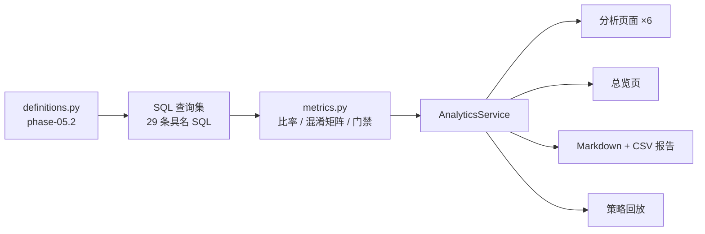
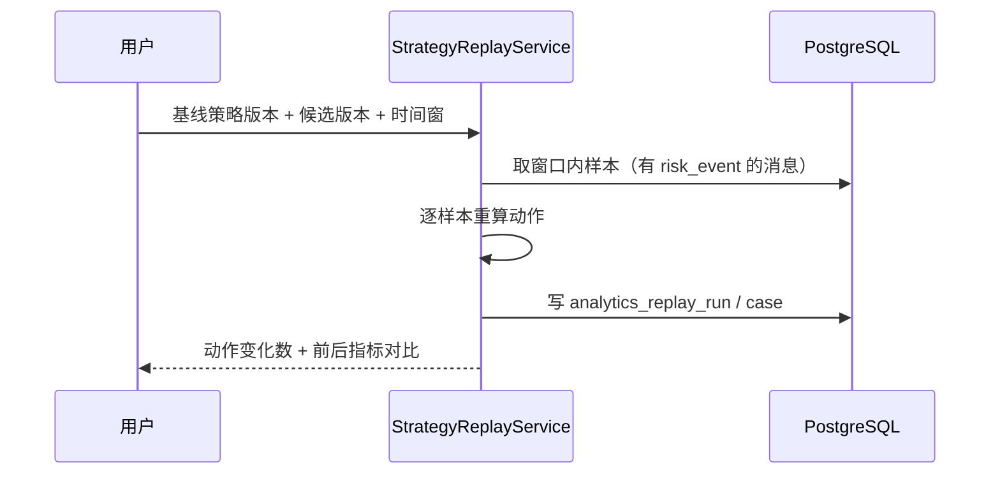

# 分析层（Analytics）

分析层要解决的问题是：**这些数字能不能信？** Claro 的做法是先定义口径、再限制发布条件，最后才画图。

## 1. 口径单一来源

所有 KPI 定义集中在一个版本号下（`phase-05.2`）。任何一个页面、报告、CSV 导出的同一指标必须来自同一个函数，不允许各自实现一遍。



## 2. 六组指标

| 组 | 指标 | 口径要点 |
|---|---|---|
| 规模 | 消息总量、风险消息数、风险消息率 | 去重消息数；时间轴统一用 `message.occurred_at` |
| 风险 | 高风险消息数、高风险占比、风险玩家数、重复违规玩家 | 高风险 = high + critical |
| 治理 | 决策总数、自动处置率、人工审核率 | 分母只含有 `decision_status` 的记录 |
| 检测质量 | 准确率、召回率、F1、误杀率、漏判率 | 来自 `risk_event` 与合成 ground truth 的对比 |
| 社区 | 服务器/联盟风险排行、玩家分布 | 按消息数归一，避免大服务器天然靠前 |
| 策略 | 逐策略命中、动作变化、回放差异 | 基线 vs 候选，逐样本比对 |

## 3. 低样本门禁

这是整个分析层最重要的设计决定：

```python
gated_rate(numerator, denominator, threshold=30, label)
# denominator == 0        → value=None, reason="分母为 0，不可计算"
# denominator < threshold → value=None, low_sample=True, 保留真实样本量
# 否则                     → value=比率
```

后果是界面上经常出现"**不可计算**"而不是一个数字。当前库里自动处置率与人工审核率就处于这个状态（分母只有 15 条）。这正是想要的效果：**宁可显示"样本不足"，也不显示一个会被误读的百分比**。

KPI 卡片的提示行会写明"样本量 8，不足，已抑制"，用户知道为什么看不到值。

## 4. 三类一致性检查

| 检查 | 方法 | 目的 |
|---|---|---|
| JOIN 扇出 | 三条独立路径重算同一指标并比对 | 防止一对多 JOIN 把消息数放大 |
| 口径漂移 | 单元测试锁定 `phase-05.2` 的计算结果 | 改代码时立刻发现口径变了 |
| 数据质量 | 15 条规则（非空、范围、参照完整性） | 发现脏数据而不是把它算进指标 |

Phase 05 已实测：三条路径重算结果一致；误杀率/漏判率覆盖 50,000 条消息；演示库不被测试污染。

## 5. 策略回放

回放回答"如果换成候选策略，会发生什么"：



回放只读原始数据，结果写入独立的 `analytics_replay_*` 表，**不修改任何业务表**。演示中回放的结论是：7 条样本、0 处动作变化、候选策略误杀率 0.286、`low_sample=true`——样本只有 7 条，所以这个结论本身被标注为不可靠。

## 6. 报告导出

`claro analytics-report` 生成 Markdown 与 CSV。Excel/PDF 没有实现（缺依赖），这一点写在限制里，不做"导出成功"的假动作。

## 7. 当前数据的真实状况

| 现象 | 原因 | 界面如何呈现 |
|---|---|---|
| 自动处置率、人工审核率"不可计算" | 有状态决策仅 15 条 | 显式标注样本量 |
| 决策动作分布含 50,003 条无状态的历史决策 | Phase 02 批量数据 | 图注说明"含历史批量决策" |
| 风险事件集中在 2026-01–02 | 基线快照的时间分布 | 总览默认"近 1 年"，图表不零填充空白日 |
| 检测覆盖率 0.03% | 基线只跑了规则批处理 | 用两位小数显示，附口径说明 |
| 误杀率/漏判率来自合成标签 | 没有真实人工标注 | 所有出现处都标注"检测层、非线上真实标注" |

这些不是缺陷清单，而是**口径透明度的证据**：每个看起来奇怪的数字，都能在界面上找到解释它为什么长这样的一句话。

## 8. 六张分析页

| 页面 | 回答的问题 |
|---|---|
| 分析总览 | 这个时间窗里发生了什么？ |
| 风险分析 | 风险在哪些类别、哪些等级堆积？ |
| 社区分析 | 哪个服务器/联盟的问题最集中？ |
| 治理分析 | 自动与人工的比例是否合理？积压多少？ |
| 模型分析 | 模型的精确率/召回率与错误样例长什么样？ |
| 策略评估 | 每条策略命中多少、准不准、换策略会怎样？ |

每张页面的侧栏都有统一的时间范围与维度筛选器，筛选条件、数据来源、口径版本、生成时间固定在页首横幅里——用户不需要猜"这个图是什么口径"。
