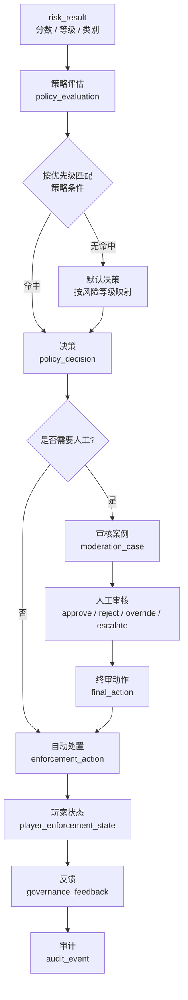
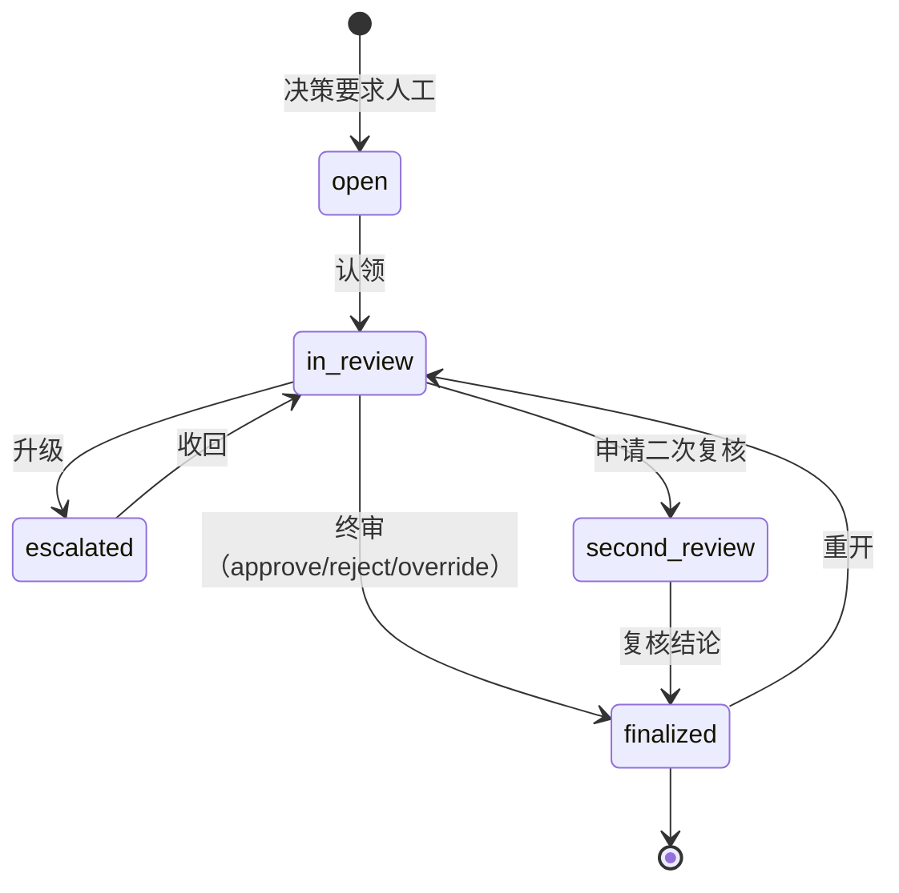

# 内容治理（Content Governance）

风险层回答"有多危险"，治理层回答"**该怎么处理，谁同意了，能不能追溯**"。这一层是 Claro 的核心，因为内容安全的难点从来不是检测，而是处置的可解释、可复核、可回滚。

## 1. 闭环

## 2. 策略

策略不是一段代码，而是**声明式条件 + 版本化**：

| 组成 | 说明 |
|---|---|
| `policy` | 逻辑策略，有 key 与适用范围 |
| `policy_version` | 不可变版本，含条件、动作、优先级、生效区间、变更原因、快照哈希 |
| `policy_rule` | 版本内的结构化条件 |

支持的策略类型（11 类）：关键词、正则、风险阈值、风险类别、玩家、服务器、联盟、白名单、黑名单、限流、组合。

**不支持任意表达式**。这是有意的安全边界：策略来自配置文件与数据库，如果允许 `eval`，一个策略编辑就等于一次远程代码执行。条件只能是白名单字段 + 比较运算 + 逻辑组合。

版本管理提供：创建新版本、回滚到历史版本、启用/停用、冲突扫描、Playground 试算。当前库里所有策略都只有 v1——历史版本对比功能已实现但**没有多版本数据可供展示**，这一点在分析页面里如实标注。

## 3. 决策降级

风险层给的是"建议动作"，治理层可能下调。两条降级规则：

| 条件 | 行为 |
|---|---|
| 置信度 < 0.55 | 高风险动作降级为 `review`（低置信不该自动封禁） |
| 高等级但置信度 < 0.70 | 降级并进入人工审核队列 |

阈值来自 `CLARO_GOVERNANCE__LOW_CONFIDENCE_THRESHOLD` 与 `HIGH_RISK_CONFIDENCE_THRESHOLD`，可配置。

决策是**确定性**的：同一消息 + 同一策略版本 + 同一风险结果，必然得到同一 `decision_key` 与同一动作。这既是幂等的基础，也让"为什么是这个结果"可以被重放验证。

## 4. 人工审核状态机

| 动作 | 语义 | 结果 |
|---|---|---|
| `approve` | 认为系统判断正确，放行 | 终审动作为 allow 或维持原动作 |
| `reject` | 认为不该处置 | 解析为 allow（不是"确认违规"） |
| `override` | 人工指定最终动作与等级 | 必须同时给 `final_action` 与 `final_level` |
| `escalate` | 超出权限，向上转 | 进入 escalated |
| `request_second_review` | 需要第二个人看 | 进入 second_review |
| `reopen` | 终审后又发现问题 | 回到 in_review |

`reject → allow` 这个映射曾经让演示脚本失败（想用 reject 触发拦截），也说明状态机不允许"用否定的名义做肯定的事"——要拦截必须显式 `override` 并给出最终动作。

## 5. 模拟处置

| 动作 | 落地 | 是否真实下发 |
|---|---|---|
| `warn` | `enforcement_action.status=executed` | 否 |
| `block` | 同上，拦截单条消息 | 否 |
| `mute` | `player_enforcement_state` + 到期时间 | 否 |
| `temp_ban` | 同上，带 `duration_seconds` | 否 |
| `perm_ban` | 同上，无到期时间 | 否 |

所有动作 `simulated=true`，**不会**调用任何游戏服务器 API。这是原型与生产的明确边界，界面与文档都这样写。

处置执行前会校验：动作必须与决策或终审动作一致，否则拒绝执行。这条约束曾经阻止过"决策是 block，却去执行 mute"的错误链路，因此保留为硬校验。

解除（release）与到期（expire）都有独立命令与记录，解除会写 `released_at` 与 `release_reason`。

## 6. 反馈与审计

**反馈**（`governance_feedback`）记录人工对系统的判断：识别正确、误杀、漏判、类别错误、等级错误、处置不合理、证据不足。反馈是后续阈值调整的唯一依据。

**审计**（`audit_event`）记录每一次变更：

| 字段 | 内容 |
|---|---|
| `entity_type` / `entity_id` | 对象 |
| `action` | 动作 |
| `actor_type` / `actor_ref` / `actor_role` | 谁做的 |
| `before_state` / `after_state` | 变更前后的状态 |
| `reason` | 为什么 |
| `created_at` / `trace_id` | 何时、属于哪条链路 |

审计是追加式的，应用层没有删除入口。但数据库层面没有防篡改（没有链式哈希或外部存证），这一点在 [KNOWN_LIMITATIONS.md](KNOWN_LIMITATIONS.md) 里写清楚了。

## 7. 追溯一条消息

`消息探查` 页面把整条链路摊在一屏里：

1. 原始内容、发送者、服务器、频道、时间
2. 融合结果：分数、等级、类别、参与层、置信度、耗时
3. 检测事件与原子证据（哪条规则、哪个模型、什么分数）
4. 处理轨迹（六个阶段的状态与耗时）
5. 治理链路：策略命中、决策、案例、审核记录、处置动作、反馈
6. 审计事件（含变更前后状态）

这是"可解释"的最终形态：不是给一个分数，而是给出一条可以被逐段核对的路径。

## 8. 演示

`scripts\run_demo.ps1` 跑 14 步，覆盖 7 个风险场景 + 认领、覆盖、禁言、临时封禁、解除、反馈、回放。整个流程用固定 ID 与固定时间锚点，因此可以重复执行——第二次全部返回 `duplicate`，不会产生重复数据。

细节见 [DEMO_SCRIPT.md](DEMO_SCRIPT.md)。
