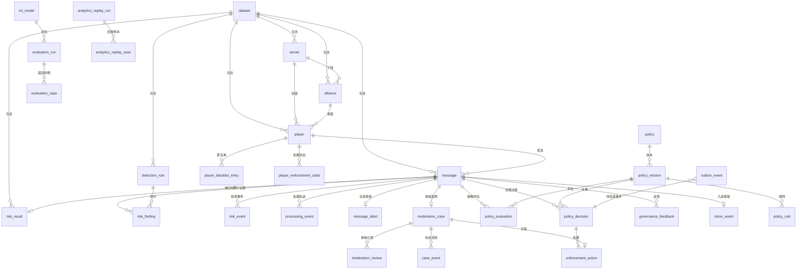

# 数据库结构（Database Schema）

PostgreSQL 18.3 是唯一的生产存储；SQLite 只用于单元测试。Schema 只能通过 Alembic 修改，当前 head 见 `alembic current`。共 **33 张表**（含 `alembic_version`），按职责分为五组。

逐表字段说明见 [DATA_MODEL.md](DATA_MODEL.md)，本文给出实体关系、分组与索引策略。

## 1. 实体关系



## 2. 表分组

| 组 | 表 | 说明 |
|---|---|---|
| **数据与实体** | `dataset`, `server`, `alliance`, `player`, `message`, `message_label` | 合成数据的基本骨架；每条记录带 `is_synthetic` |
| **检测与风险** | `detection_rule`, `risk_finding`, `risk_event`, `risk_result`, `ml_model`, `evaluation_run`, `evaluation_case` | 从原子证据到融合结果 |
| **治理与处置** | `policy`, `policy_version`, `policy_rule`, `policy_evaluation`, `policy_decision`, `moderation_case`, `moderation_review`, `moderation_record`, `case_event`, `enforcement_action`, `player_blacklist_entry`, `player_enforcement_state` | 策略 → 决策 → 审核 → 处置闭环 |
| **分析** | `analytics_replay_run`, `analytics_replay_case` | 策略回放与指纹对比 |
| **运维与审计** | `inbox_event`, `processing_event`, `outbox_event`, `audit_event`, `governance_feedback`, `alembic_version` | 幂等、轨迹、审计、反馈 |

## 3. 关键约束

| 约束 | 位置 | 目的 |
|---|---|---|
| `uq_message_external_message_id` | `message` | 同一外部消息只入库一次 |
| `uq_inbox_event_source` | `inbox_event(source_topic, source_partition, source_offset)` | Kafka 偏移量级去重 |
| `uq_risk_result_message_id` | `risk_result` | 每条消息一个融合结果 |
| `uq_policy_decision_decision_key` | `policy_decision` | 决策幂等（确定性哈希） |
| `uq_moderation_case_message_id` | `moderation_case` | 每条消息最多一个案例 |
| `uq_processing_event_message_sequence` | `processing_event` | 阶段轨迹顺序唯一 |
| `uq_enforcement_idempotency` | `enforcement_action` | 同一决策同一动作不重复执行 |

## 4. 索引策略

索引不是凭感觉加的，而是按查询形态设计：

| 索引 | 支撑的查询 |
|---|---|
| `message(player_id, occurred_at)` 等四组复合索引 | 玩家/服务器/联盟/发送者维度的按时间过滤 |
| `risk_event(dataset_id, category, occurred_at)` | 类别分布与时间窗聚合 |
| `risk_result(risk_level, detected_at)` | 风险等级分布 |
| `policy_decision(decision_status, decided_at)` | 自动处置率、审核率的分母统计 |
| `moderation_case(status, due_at)` / `(status, priority)` | 待办队列与逾期判定 |
| `inbox_event(status, next_retry_at)` | 重试扫描 |

Phase 06 用基准测试验证了聚合查询的真实开销，并把两个"每行一次 LATERAL"的查询改写为"一次分组 + 连接"（详见 [PHASE_06_PERFORMANCE.md](PHASE_06_PERFORMANCE.md)）。**没有基于猜测新增索引**：现有索引已能被聚合查询命中，实测耗时瓶颈在查询形态而不在索引缺失。

## 5. 迁移

```powershell
scripts\run_migrations.ps1                 # 升级到 head
scripts\run_migrations.ps1 -Sql            # 只打印 SQL，不执行
scripts\run_migrations.ps1 -Revision <id>  # 升到指定版本
```

- 迁移脚本位于 `migrations/versions/`，按时间戳前缀排序。
- `alembic check` 必须无漂移；CI 与本地都应通过。
- 降级路径保留了 Phase 02 以来的 `downgrade()`，但**未在含真实数据的库上执行过**，因此不作为可回滚承诺。
