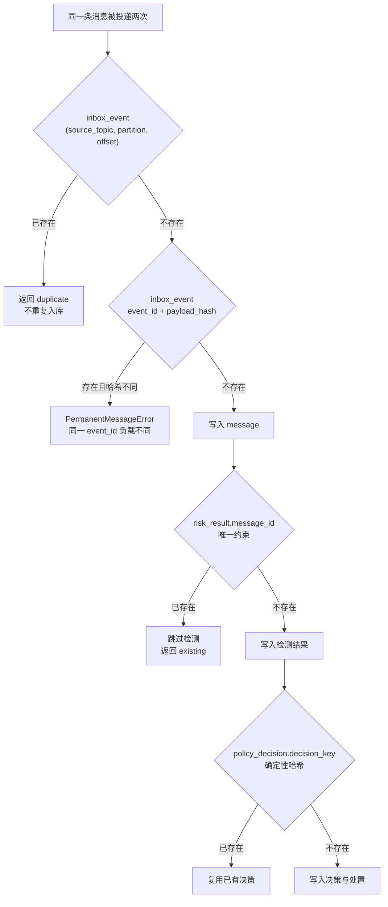
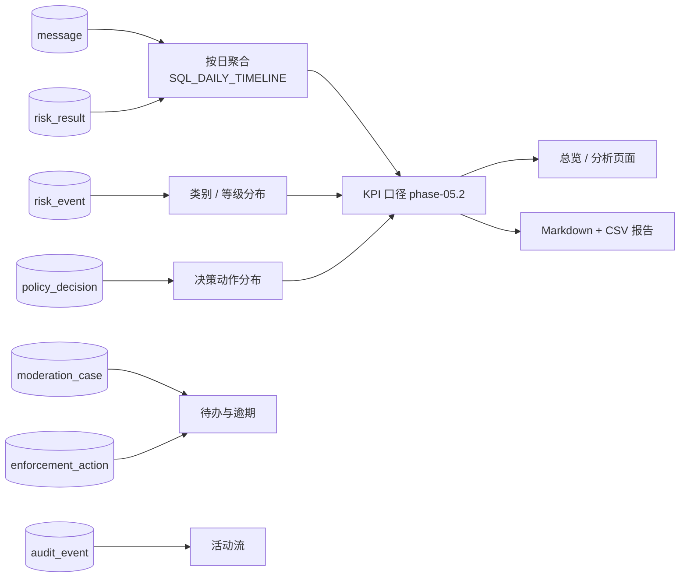

# 数据流（Data Flow）

Claro 的数据从一条游戏内聊天消息开始，最终变成一条可解释的治理决策、一次模拟处置，以及分析层的一组指标。本文按"数据在哪里变形"的顺序描述这条链路，每一跳都标注了真实落点（表名 / Topic / 缓存键）。

## 1. 全景

```mermaid
flowchart LR
    subgraph Source["数据来源"]
        A1["合成生成器<br/>Seed 驱动"]
        A2["Kafka 原始 Topic<br/>game.messages.raw"]
        A3["CLI 单条注入<br/>claro process-message"]
    end

    subgraph Ingest["入库与幂等"]
        B1["validate<br/>Pydantic 严格校验"]
        B2["ingest<br/>inbox_event 去重"]
        B3[("message<br/>player / server / alliance")]
    end

    subgraph Detect["检测与融合"]
        C1["preprocess<br/>归一化 / 变体还原"]
        C2["规则层<br/>关键词 / 正则 / 黑白名单"]
        C3["ML 层<br/>char_wb TF-IDF + LR"]
        C4["语义 / LLM 层<br/>默认不可用"]
        C5["融合<br/>加权 noisy-OR"]
        C6[("risk_result<br/>risk_finding / risk_event")]
    end

    subgraph Govern["治理决策"]
        D1["策略评估<br/>policy_evaluation"]
        D2["决策<br/>policy_decision"]
        D3["人工审核<br/>moderation_case / review"]
        D4["模拟处置<br/>enforcement_action"]
    end

    subgraph Serve["对外服务"]
        E1["Kafka 风险/治理事件<br/>outbox_event"]
        E2["分析层<br/>29 条具名 SQL"]
        E3["Streamlit 界面<br/>15 个页面"]
    end

    A1 --> B1
    A2 --> B1
    A3 --> B1
    B1 --> B2
    B2 --> B3
    B3 --> C1
    C1 --> C2
    C1 --> C3
    C1 --> C4
    C2 --> C5
    C3 --> C5
    C4 --> C5
    C5 --> C6
    C6 --> D1
    D1 --> D2
    D2 --> D3
    D3 --> D4
    D2 --> E1
    D4 --> E1
    C6 --> E2
    D2 --> E2
    D4 --> E2
    E2 --> E3
    D3 --> E3
    D4 --> E3
```

## 2. 单条消息的六个阶段

统一入口是 `ClaroProcessingService.process_message()`。它不重写任何已有逻辑，而是把 Phase 02–05 的服务编排起来，并按阶段记录耗时与状态。

| 阶段 | 代码位置 | 写入 | 失败后果 |
|---|---|---|---|
| validate | `application/message_events.py` | 无 | `failed`，不产生任何行 |
| ingest | `data_access/repositories/kafka_repository.py` | `inbox_event`, `message`, `player`, `server`, `alliance` | `failed`，幂等键冲突时降级为 `duplicate` |
| detect | `application/risk_service.py` + `risk_engine/*` | `risk_result`, `risk_finding`, `risk_event` | `partial`，消息仍在库中等待重跑 |
| publish | Kafka producer | `game.risk.assessed.v1` | `partial`，事件可由补偿命令重发 |
| governance | `application/governance_pipeline_service.py` | `policy_evaluation`, `policy_decision`, `moderation_case`, `enforcement_action`, `audit_event` | `partial`，`outbox_event` 保留待投递 |
| 结果 | — | `processing_event` 每阶段一行 | — |

`ProcessingOutcome.status` 只有四种取值，含义固定：

| status | 含义 |
|---|---|
| `processed` | 全部阶段成功，且本轮新建了消息 |
| `duplicate` | 幂等命中，各阶段返回 `duplicate` 或 `existing`，未写新行 |
| `partial` | 消息已入库，但下游某阶段失败，需要重试 |
| `failed` | 校验或入库失败，消息未进入系统 |

## 3. 幂等与一致性

三个不同层次的幂等键，缺一不可：

* **入库去重**：`inbox_event` 上有 `(source_topic, source_partition, source_offset)` 唯一索引，同时用 `event_id` 作主键；`payload_hash` 是内容寻址的，重放同一消息不会因为时间戳不同而被误判为新负载。
* **检测去重**：`risk_result.message_id` 唯一，重复检测更新而不是追加。
* **决策去重**：`decision_key` 由消息、策略版本、动作确定性地哈希得到，重复决策得到同一行。
* **事件发布**：`outbox_event` 先落库再投递，投递成功后置为 `published`；投递失败保留待重试，因此"数据库提交了但 Kafka 没收到"不会丢事件。

## 4. 数据规模与保留现状

| 数据集 | 消息 | 说明 |
|---|---|---|
| `phase-01-synthetic-v1` | ~50,000 | 分析层基线，`message_label` 提供合成 ground truth |
| `phase-06-demo-s20261125` | 7 | 演示场景，固定 ID 与固定时间锚点，可一键清理 |
| 各类集成测试数据集 | 少量 | `phase-02-synthetic-gov-it-*` 等，随测试生成 |

时间分布是不均匀的：`risk_event` 集中在 2026-01-01 至 2026-02-01（基线快照），演示数据集中在 2026-11-25。因此总览页默认时间窗为"近 1 年"，并且图表只画有数据的日期，不做零填充。

## 5. 分析层如何取数

分析层不读 `risk_event` 的明细做实时聚合，而是基于 29 条具名 SQL（`analytics/sql_queries.py`）在 PostgreSQL 上直接聚合。KPI 口径单一来源是 `phase-05.2`，任何页面都不得自行定义公式：

低样本门禁在这一层强制执行：分母小于 30 的比率不返回数值，只返回 `low_sample=true` 与真实样本量，界面显示"不可计算"。这条规则使得空库或小数据集下不会出现 0% 或 100% 的假指标。
