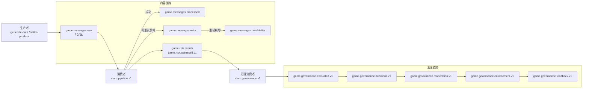
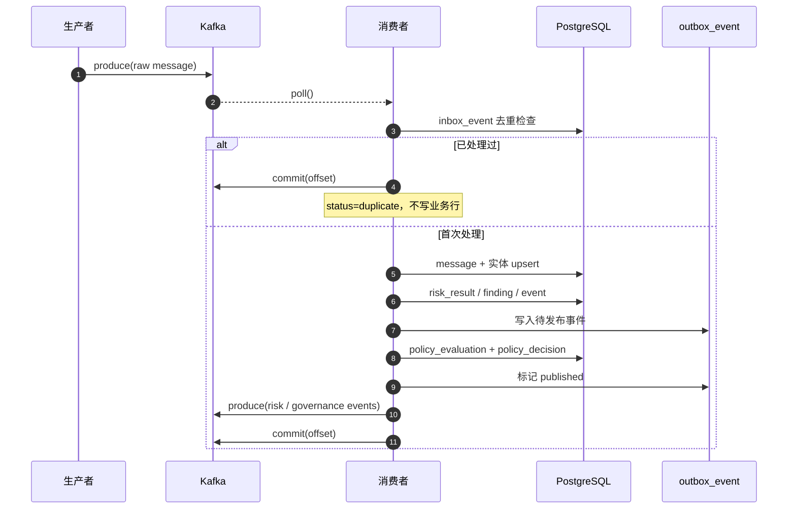
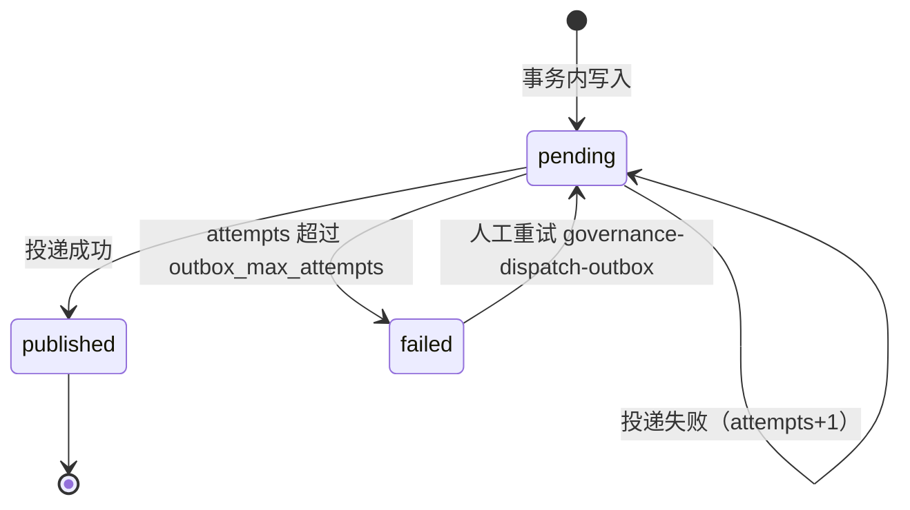

# 事件流（Event Flow）

Claro 使用 Kafka 3.9.2（KRaft 单节点）承载两类事件：**内容事件**（原始消息 → 处理完成 → 风险评估）与**治理事件**（策略评估 → 决策 → 审核 → 处置 → 反馈）。本文说明 Topic 拓扑、投递语义和失败处理。

## 1. Topic 拓扑

| Topic | 生产者 | 消费者组 | 用途 |
|---|---|---|---|
| `game.messages.raw` | 数据生成器 / CLI | `claro.pipeline.v1` | 原始游戏内消息 |
| `game.messages.processed` | 流水线 | — | 已入库的消息回执 |
| `game.messages.retry` | 流水线 | `claro.pipeline.retry.v1` | 可重试失败，延迟重投 |
| `game.messages.dead-letter` | 流水线 | — | 重试耗尽或不可重试错误 |
| `game.risk.assessed.v1` | 风险引擎 | `claro.governance.v1` | 融合后的风险结果 |
| `game.governance.*` | 治理服务 | — | 评估、决策、审核、处置、反馈 |

## 2. 一次投递的生命周期

**至少一次（at-least-once）+ 幂等消费**是这里的设计前提：偏移量在业务事务成功之后才提交，因此进程崩溃会导致重复投递，而重复投递由三层幂等键吸收（见 [DATA_FLOW.md](DATA_FLOW.md)）。

## 3. 失败分类与处置

| 情形 | 判定 | 处置 |
|---|---|---|
| 消息格式非法 | `MessageSerializationError` | 直接进死信，不重试（重试不会变好） |
| 同一 `event_id` 负载不同 | `PermanentMessageError` | 直接进死信，标记为数据污染 |
| 数据库临时不可用 | 连接异常 | 进 `retry` Topic，退避重投 |
| 检测服务异常 | 非致命，消息已入库 | 记录 `partial`，可通过 `claro risk-detect --dataset` 重跑 |
| 事件发布失败 | Kafka 不可达 | `outbox_event` 保留 `status <> published`，`governance-dispatch-outbox` 补偿 |
| 重试耗尽 | `attempts > max_retries` | 进死信并写入 `inbox_event.status='dead_letter'` |

死信不是垃圾桶：每条死信都带着原始偏移量、失败原因和尝试次数，`claro kafka-group` 可以查看积压，`claro kafka-consume` 可以重放。

## 4. 治理事件与 Outbox

治理链路的写入和投递必须原子。Claro 的做法是先在同一事务内写业务行与 `outbox_event`，再由独立的派发步骤投递：

`outbox_event.dedupe_key` 保证同一业务事实不会产生两条待发事件；这也是回放与重放安全的基础。

## 5. 缓存与事件的配合

Redis 缓存的是"读多写少的配置类数据"，不是事件本身：

| 键 | TTL | 失效时机 |
|---|---|---|
| `claro:sensitive_words:{scope}` | 300s | 规则同步后主动失效 |
| `claro:policy:{key}` | 60s | 策略版本变更后主动失效 |
| `claro:blacklist:{player}` | 依策略 | 拉黑 / 解除时删除 |
| `claro:rate:{scope}` | 窗口长度 | 原子脚本自增，不主动删 |

缓存未命中直接回落到 PostgreSQL，Redis 完全不可用时系统仍可运行（只是变慢）。缓存从不作为"唯一真相"，因此不存在缓存与数据库不一致导致决策错误的情形。
