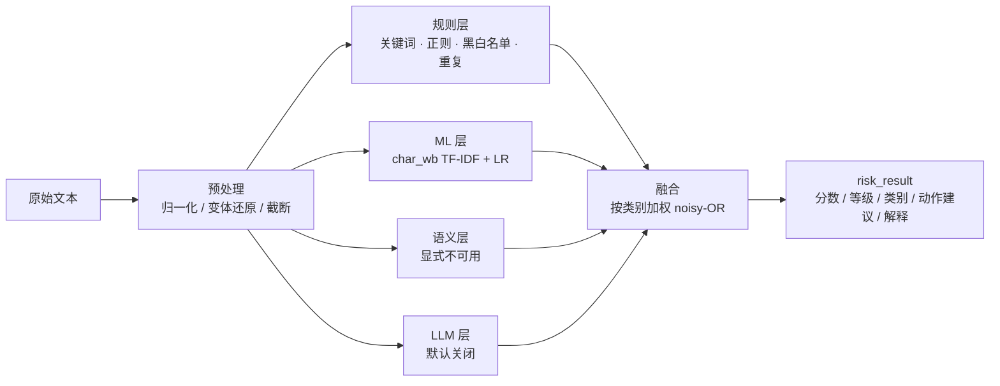

# 风险智能（Risk Intelligence）

风险层回答一个问题：**这条消息有多危险，为什么？** 它不直接决定处置，而是产出一个可解释的融合结果（`risk_result`），交给治理层按策略裁决。

## 1. 四层检测



| 层 | 状态 | 权重 | 说明 |
|---|---|---|---|
| 规则 | 可用 | 0.90 | 22 条 YAML 规则，同步到 `detection_rule`（当前库内 63 条含历史版本） |
| ML | 可用（合成训练） | 0.80 | 字符级 TF-IDF + One-vs-Rest 逻辑回归，多标签 |
| 语义 | **不可用** | 0.60 | 返回显式"不可用"状态，不产出分数 |
| LLM | 默认关闭 | 0.50 | 仅作顾问层；缺凭据时拒绝启动而非静默跳过 |

权重不是拍脑袋定的：规则可精确解释所以最高，ML 有一定泛化但有假阳性所以次之，语义/LLM 不可审计所以最低。某层缺席时，融合按剩余层重新归一化，而不是把缺失当成 0 分。

## 2. 融合公式

每个检测器产出一个 `Finding(detector, category, score, confidence)`。融合按类别分组，组内做加权 noisy-OR：

```
p_category = 1 - Π(1 - w_layer × score_i)
risk_score = max(p_category) 增益后按类别严重度调整
```

- `severity_scores`：low 0.35 / medium 0.55 / high 0.75 / critical 0.95
- `ml_min_probability = 0.50`：低于此概率的 ML 输出不进入融合

## 3. 等级与建议动作

| 分数区间 | 等级 | 建议动作 |
|---|---|---|
| < 0.20 | normal | allow |
| < 0.45 | low | warn |
| < 0.70 | medium | review |
| < 0.90 | high | block |
| ≥ 0.90 | critical | restrict |

这组阈值在 `config/risk_thresholds.yaml` 中，与治理层的决策阈值是**两套独立配置**：风险层给建议，治理层按策略与置信度决定最终动作（可能降级）。

## 4. 类别体系

19 个类别（18 风险 + normal），分布在 7 个领域中。数据库列存的是 `db_category`，展示层用中文标签：

| 类别 | 展示名 | 语义色 |
|---|---|---|
| `spam` | 垃圾广告 | 警示 |
| `fraud` | 欺诈诱导 | 危险 |
| `harassment` | 骚扰辱骂 | 危险 |
| `hate_speech` | 仇恨言论 | 危险 |
| `violence` | 暴力内容 | 危险 |
| `sexual_content` | 色情内容 | 紫 |
| `self_harm` | 自伤风险 | 紫 |
| `other` | 其他 | 中性 |

新增类别需要改 `config/risk_taxonomy.yaml` 并重新训练模型，没有在线学习。

## 5. 模型资产

| 项 | 现状 |
|---|---|
| 算法 | char_wb TF-IDF（1–4 gram，最多 100k 特征）+ One-vs-Rest 逻辑回归 |
| 训练数据 | 合成语料 + `message_label` 真值，玩家级切分防泄漏 |
| 评估 | `evaluation_run` + `evaluation_case`（错误样例逐条落库） |
| 产物 | `models/` 目录，**被 `.gitignore` 忽略** |
| 风险 | 模型文件缺失时 ML 层静默缺席，融合只剩规则层 |

这不是一个可以隐瞒的问题：如果 clone 仓库后没有模型文件，"模型分析"页会显示"还没有登记模型"，检查覆盖页的原子证据也只来自规则层。界面文案就是这么写的。

## 6. 风险情报页

`风险情报` 页面把上面这些事实摊开：

- **检测覆盖**：消息总量、已出融合结果数、覆盖率、原子证据数
- **检测层命中**：每个 detector 的命中数、覆盖消息数、最近命中时间
- **风险类别使用**：每个类别的事件数、覆盖消息、平均分（进度条直观显示阈值松紧）
- **规则目录**：63 条规则的 key、类型、状态、版本、命中次数（含 0 命中的规则——看不见的规则才是危险的）
- **模型资产**：模型卡片、指标、训练/评估时间、产物路径
- **最近评估运行**：数据集、切分、样本数、指标

## 7. 当前真实数据状况

| 指标 | 值 | 说明 |
|---|---|---|
| 消息总数 | 50,018 | 含 50,000 基线 + 演示 + 测试残留 |
| 已出融合结果 | 17 | 只有经过完整检测链路的消息才有 |
| 覆盖率 | 0.03% | 这是真实值，不是 bug：基线数据集只跑了规则层批量检测，没跑融合 |
| 原子证据 | 8,897 | `risk_finding` 行数 |
| 风险事件 | 8,856 | 按类别聚合后的事件数 |

覆盖率低是数据层面的历史事实。把它显示成 0.0% 会误导，所以界面用两位小数并在文案里说明来源。

## 8. 为什么"命中多"不等于"效果好"

Phase 05 的策略评估已经证明过：某些规则命中量大但精确率低。风险情报页的"平均分"列用于识别这类情况——某个类别平均分长期贴近阈值时，说明阈值或规则需要重新标定，而不是继续加规则。
