# Claro — SLG 游戏内容安全治理平台

**面向 SLG 游戏社区的内容安全与风险治理平台原型**

Claro 是一个围绕 SLG 游戏社区内容安全场景设计的平台原型，旨在探索如何将内容风险识别、策略管理、人工审核和处置分析整合到一套完整的治理流程中。

在 SLG 游戏中，玩家之间的交流不仅发生在聊天频道，还涉及联盟、邮件、公告和昵称等多种场景。不同场景下的内容风险、传播方式和处理要求并不相同。单纯依靠文本识别难以满足实际治理需求，还需要结合业务场景制定处理策略，并为人工审核和后续分析提供支持。

基于这一问题，我主导了 Claro 的业务设计与整体开发规划，并借助 AI 编程工具完成项目实现。开发过程中，我负责需求定义、阶段规划、任务拆解、Prompt 编写以及功能验证和迭代，AI 主要承担代码实现工作。

项目围绕内容检测、策略管理、审核工作流、处置记录和数据分析展开，尝试构建从风险发现到治理反馈的完整流程。

**项目概况**

- 项目类型：个人项目 / AI 辅助开发
- 业务领域：SLG 游戏内容安全与风险治理
- 项目角色：项目规划、业务设计与开发管理
- 开发方式：AI 辅助编程，分阶段迭代
- 核心技术：Python、PostgreSQL、Kafka、Redis、SQL
- 项目状态：可本地运行的功能原型

项目使用模拟业务数据进行功能开发与验证，主要用于展示业务分析、策略设计和工程实现思路，并非已部署的商业化游戏审核系统。项目尚未进行真实线上业务验证。

**5 分钟摘要**

- **业务理解**：围绕 SLG 游戏中的多种玩家交流场景，梳理内容风险及治理需求，探索从风险识别到审核处置的系统化解决方案。
- **策略设计**：设计内容检测、风险分级、策略配置和人工审核机制，使风险识别结果能够进一步转化为具体的治理动作。
- **系统实现**：通过 Python、Kafka、Redis 和 PostgreSQL 等技术构建平台原型，覆盖消息处理、风险检测、策略管理、审核工作流及数据分析等模块。
- **AI 协作开发**：采用分阶段开发方式，由我负责整体规划、任务拆解、Prompt 编写和结果验收，借助 AI 编程工具完成大部分代码实现。
- **项目价值**：将游戏内容安全业务需求转化为可运行的系统原型，展示从业务分析、策略设计到技术实现和功能验证的完整过程。

---

## 1. Project Overview

### 1.1 项目要解决什么问题

Claro 的目标是让一条玩家消息从进入系统开始，就能完成风险识别、策略判断、人工审核、处置记录和后续分析：

**消息接入 → 风险检测 → 策略判断 → 人工审核 / 模拟处置 → 反馈与分析**

项目重点回答三个业务问题：

1. **内容有什么风险**：系统识别出了哪些信号，为什么这样判断？
2. **应该如何处理**：结合当前玩家、服务器、联盟、频道和策略，应该放行、提醒、送审还是限制？
3. **如何形成闭环**：审核员如何处理，处置能否追踪，误判如何进入下一轮策略调整？

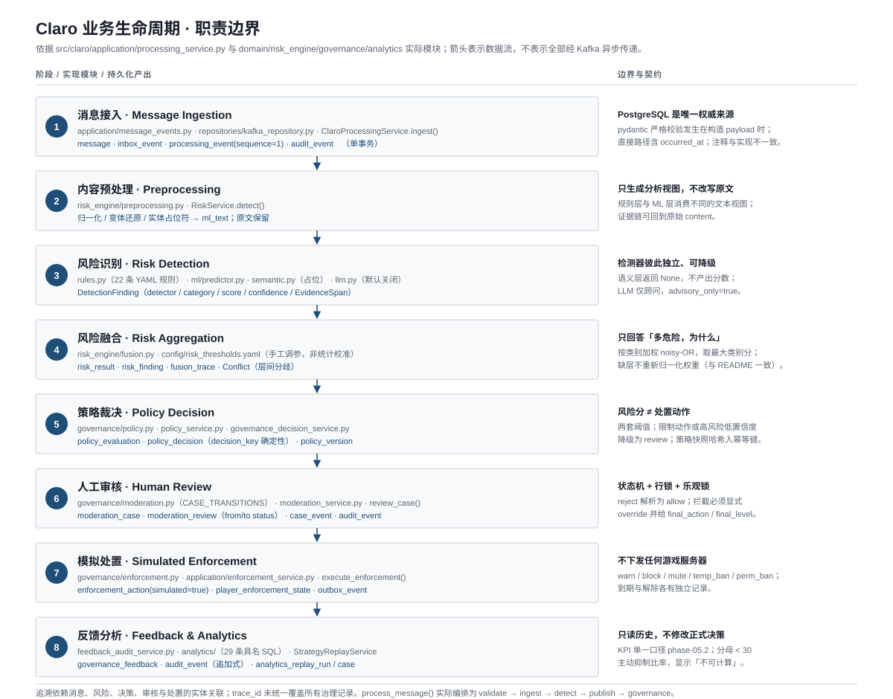

### 1.2 我的角色与开发方式

我负责 Claro 的整体规划与开发推进，采用 AI 辅助编程的方式完成项目。

项目开始时，我先明确业务场景和产品目标，再将整体开发拆分为多个阶段，为每个阶段制定具体任务和交付要求。在实际开发中，我通过 Prompt 向 AI 描述功能需求、技术约束和预期结果，由 AI 完成主要代码编写。

每个阶段完成后，我会在本地运行项目，检查功能表现、数据结果和运行情况。对于不符合预期的部分，我会进一步分析问题、调整需求描述，并让 AI 继续修改，直到达到阶段验收要求。

这种开发方式让我能够将更多精力放在业务问题分析、系统规划、技术方案判断和结果验证上，同时利用 AI 提高原型开发效率。

### 1.3 当前交付概况

| 维度 | 实际交付 |
| --- | --- |
| 应用形态 | Python 模块化单体，覆盖界面、业务处理、风险识别、治理和数据分析 |
| 业务链路 | 统一消息处理入口，支持直接处理与 Kafka 事件消费 |
| 数据与基础设施 | PostgreSQL 保存业务数据，Kafka 处理事件，Redis 提供缓存 |
| 产品界面 | Streamlit，15 个页面、5 个导航组，支持 Light / Dark / System |
| 风险能力 | 22 条检测规则、字符级 TF-IDF / Logistic Regression 多标签模型和融合评分 |
| 治理能力 | 版本化策略、风险分级、人工审核、五类模拟处置、反馈与审计 |
| 验证材料 | 7 条端到端演示消息、308 项最终测试记录、模型评估、串行性能基准与策略回放 |

这个项目最重要的不是页面数量，而是把识别风险、制定策略、人工审核和处置记录分成清楚但又相互衔接的环节。检测结果可以用于不同策略；策略变化会保留历史版本；人工审核会记录原判断、修改理由和最终动作。

---

## 2. Problem & Strategy Design

### 2.1 SLG 风险为什么不能只做文本分类

SLG 内容治理同时面对内容、关系和行为上下文。以合成场景为设计输入，一条“代练、出号”的消息可能同时包含广告、外部联系方式、交易与欺诈信号；一次辱骂可能是单次冲突，也可能是玩家在多个频道重复违规。**同一个标签不必然对应同一个动作，不同标签也可能需要同一类治理。**

因此，我把业务问题拆成四层：

| 层次 | 要回答的问题 | 对应产品设计 |
| --- | --- | --- |
| 风险定义 | 什么算广告、诈骗、骚扰，什么应被排除 | 分类法、纳入/排除条件、严重度与标注口径 |
| 风险识别 | 有哪些规则或模型证据，是否互相冲突 | 规则、ML、融合轨迹与证据片段 |
| 治理策略 | 当前上下文下应该允许、警告、观察、送审还是限制 | 条件、作用范围、优先级、策略版本与置信度门槛 |
| 运营闭环 | 谁复核、如何处置、如何反馈、如何比较新策略 | 审核状态机、模拟处置、审计、指标与离线回放 |

一个具体的标注边界是“联盟招募”：只有游戏内协作、没有外部联系或付款时，不应直接判成广告；一旦出现“代练套餐、私聊下单、站外联系方式”，才叠加广告、交易与欺诈信号。同样，“有人发布领取金币链接，请勿相信”包含风险词，但语义是提醒或举报，不应因为关键词命中就处罚。分类法的纳入/排除条件与规则的 `negative_terms` 都在处理这类语境。

### 2.2 如何把风险类别转成处理策略

| 目标风险 | 业务解释与策略问题 | Claro 的实际处理 | 状态 |
| --- | --- | --- | --- |
| 广告 / 导流 | 区分正常游戏讨论、官方公告与非官方拉人；低置信度误杀可能伤害正常协作 | 关键词、重复刷屏、字符洪水、非官方 URL、黑名单域名、站外联系方式和社群邀请规则；策略可结合频道、服务器、玩家与分数 | 已实现 |
| 色情 / 政治 / 敏感内容 | 色情、政治敏感与泛化“敏感”需要分开定义和处理 | 色情内容规则和模型标签已实现；政治敏感识别尚未实现 | 部分实现 |
| 欺诈 / 黑市活动 | 诈骗、账号出售、代练、虚拟资产交易都涉及证据与后果差异，高风险不应简单等同于自动封禁 | 假奖励、垫付诈骗、凭据钓鱼、账号出售、代练、站外资产交易规则；细分类别存在，部分落库为 `other` | 已实现基础规则，无真实黑市数据 |
| 辱骂 / 群体对立 / 威胁 | 需要区分个人冲突、组织化围攻与现实威胁，并保留上下文供人复核 | 人身攻击、群体敌意、现实威胁规则；审核工作台支持升级、二次复核与推翻 | 已实现 |
| 自伤与其他高风险信号 | 高分信号需要明确送审，不应由检测器直接执行惩罚 | 自伤规则和模型标签；高风险可由策略路由到人工审核 | 已实现基础识别 |

项目的风险分类法包含 7 个领域、19 个细分类别；数据库和模型使用 8 个落库类别。细分类别用于业务定义和标注，模型标签保持更粗的粒度，账号交易等类别会映射到 `other`。政治敏感识别属于后续扩展方向。

### 2.3 目标场景与当前实现

项目需求覆盖游戏聊天、联盟内容、玩家邮件、游戏公告和玩家昵称。当前原型已完成游戏聊天治理，并在联盟频道和策略范围上提供部分支持；其余场景作为后续扩展方向：

| 载体 | 关键风险与上下文 | 策略思路（部分尚未实现） | 当前实现 |
| --- | --- | --- | --- |
| 游戏聊天 | 广告、欺诈、骚扰、刷屏；发送者、服务器、联盟、频道与重复行为 | 用内容信号识别风险，用上下文决定动作；普通协作保留，高风险或低置信度送审 | **端到端实现** |
| 联盟内容 | 联盟内招募与协作、组织化围攻、局部范围传播 | 区分正常联盟运营与有组织骚扰；策略至少应结合联盟范围、重复发送和群体关系 | **部分实现**：有联盟频道与策略范围，无独立帖子/公告板/审批流 |
| 玩家邮件 | 私信诈骗、定向导流、持续骚扰 | 不能只判单条文本，应结合收件人、会话线程、发送历史和是否要求站外交易；私信高风险需要更明确的复核路径 | **未实现**：`private` 只是频道字符串 |
| 游戏公告 | 伪造官方公告、钓鱼链接、大受众误导 | 公告应在发布前审核，并校验官方来源、受众范围和链接白名单；不能套用普通聊天的默认动作 | **未实现**：`system` 只是采样频道 |
| 玩家昵称 | 冒充身份、仇恨/色情表达、违规身份展示 | 需要归一化、混淆字和账号历史；处置对象应是账号，而不是某一条消息 | **未实现**：`display_name` 不进入检测链路 |

因此，当前最完整的产品闭环是**通用游戏聊天治理**。邮件、公告和昵称需要补充独立的数据模型、检测入口和治理动作，表格中列出的是相应的策略思路。

### 2.4 从风险识别到处理动作

以演示集中一条自伤信号为例：

- 检测层输出 `critical`、风险分 `0.9604`、置信度 `0.9861`，建议动作为 `restrict`；
- 治理层根据当前策略输出 `review`，状态为 `pending_review`，并创建审核案例；
- 处置层支持 `warn / block / mute / temp_ban / perm_ban`，不会直接执行检测器给出的 `restrict`；具体动作由策略和审核决定，并记录为模拟处置。

另一条多信号交易消息的风险分为 `0.54`，检测建议为 `review`，治理策略最终输出 `warn` 并自动生成模拟警告。两个例子说明：**风险建议是策略输入，不是最终动作；策略可以更严格，也可以在满足规则时调整动作。**

当前策略机制包括：

- 5 个风险等级，以及检测阈值和治理置信度阈值两套口径；
- 默认动作映射：normal / low 允许，medium 警告，high / critical 送审；
- 限制性动作在置信度低于 `0.55` 时降级为审核；high / critical 风险置信度低于 `0.70` 时，非审核动作也会转审核；
- 玩家、服务器、联盟、频道、语言作用范围，以及关键词、正则、风险阈值、组合、白名单、黑名单等声明式条件；
- 不可变策略快照、SHA-256 快照哈希、版本比较和“回滚即创建新版本”；
- 确定性策略排序，减少同分冲突造成的动作漂移。

### 2.5 审核、处置与反馈如何形成闭环

审核不是简单的“通过 / 拒绝”。Claro 实现认领、批准、拒绝、覆盖、升级、二次审核、终结和重开，并用数据库行锁与 `lock_version` 控制状态迁移。拒绝表示“认为不应处置”；如果要限制玩家，审核人必须显式覆盖系统动作并提供最终动作与等级。

处置层支持五类动作，并记录对象、时长、到期、解除、审核单、策略版本和操作信息。当前动作全部标记为 `simulated=true`，只写入本地记录，用于演示处置流程，不会影响真实账号。

反馈层记录误杀、漏判、类别错误、等级错误、处置不合理和证据不足等类型，供查询、汇总和策略复盘使用。模型重训和策略发布仍由人工决定。真实运营还需要补充复核一致性、复核时长、申诉率和二次复核率等数据。

### 2.6 我会如何推进一次策略迭代

如果进入真实项目，我会按以下步骤推进策略迭代；当前原型只实现了其中的离线回放部分：

1. **先定义目标与护栏**：同时看误杀、漏放、审核量和重复违规，不把命中量或自动处置率当唯一目标。
2. **做错误归因**：按类别、频道、服务器/联盟、风险等级、置信度和策略版本切片；误伤重点看语境误判、白名单过宽和作用域错误，漏放必须从未命中的正常样本中抽样，不能只看已报警样本。
3. **形成候选版本**：分别验证规则、阈值、作用域和动作，避免一次改动无法归因；保留变更原因和预期影响。
4. **离线回放**：在同一批含正常与风险样本的输入上比较质量、误杀、漏判和审核成本；Claro 已实现这一层。
5. **小范围验证与回滚**：真实业务应限范围发布，观察申诉和重复违规，并设置回滚条件；灰度发布、线上监控和自动回滚属于后续能力。

### 2.7 敏感词与黑名单目前能做什么

项目已经具备 22 条检测规则、规则黑名单项、策略关键词和黑名单类型，以及玩家黑名单的数据存储与缓存能力。目前它还不是一套完整的敏感词库产品：玩家黑名单尚未与消息治理和界面形成完整联动，规则配置也还没有覆盖词库的审核、发布、版本和撤回流程。

---

## 3. System Design

### 3.1 系统如何支撑这些业务流程

考虑到本地运行、业务联调和事务处理的需要，项目采用模块化单体：不同业务模块保持清晰边界，又能在同一进程中完成消息处理和治理流程。

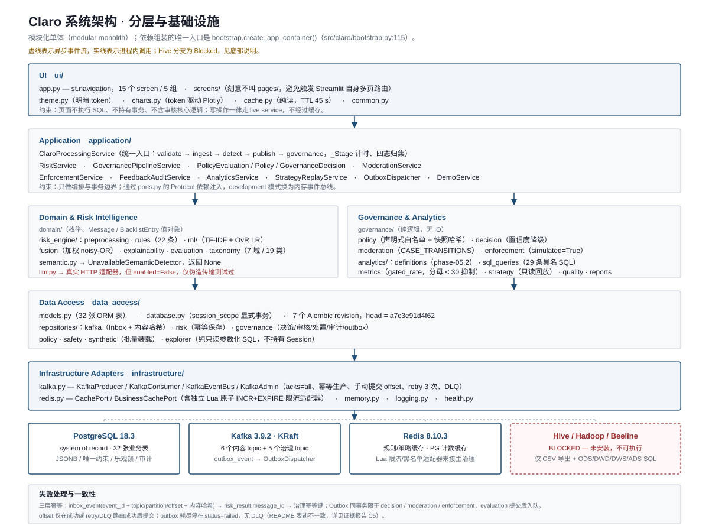

| 层 | 核心职责 | 关键设计 |
| --- | --- | --- |
| UI | 队列、策略、处置、分析与配置操作 | 页面只调用服务，不直接执行 SQL，不持有事务 |
| Application | 串起处理、治理、审核、反馈和回放 | 统一入口、Protocol 依赖注入、明确事务边界 |
| Domain / Risk | 分类、规则、模型、融合、策略与状态机 | 核心规则尽量保持纯逻辑，便于单元测试 |
| Data Access | PostgreSQL 持久化、唯一约束、行锁与审计 | Repository 模式，显式 session 事务 |
| Infrastructure | Kafka、Redis、内存总线、日志与健康检查 | full / development 两种模式可替换适配器 |
| Analytics | KPI、报表、策略效果和只读回放 | 统一指标口径，低样本不发布误导性比率 |

### 3.2 先识别风险，再决定如何处理

检测层负责说明风险，具体动作由策略和审核决定：

- 规则层提供类别、分数、严重度和原文证据片段；
- ML 层使用 `char_wb` TF-IDF（1–4 gram）和 One-vs-Rest LogisticRegression，输出 8 个类别的概率；
- 融合层按类别计算加权 noisy-OR：`1 - PRODUCT(1 - layer_weight × strength)`；
- 总体风险分取最高类别分，同时保留每层贡献、公式、阈值和层间冲突；
- 权重是手工设定，不是统计校准结果；缺层时减少贡献，不把缺失当作零分或重新归一化。

### 3.3 策略版本与人工审核

策略快照把条件、范围、动作、优先级和有效期固定下来，使历史决策可以解释。更新时的 `expected_version` 是应用层检查，不是数据库 CAS；审核案例则使用 `SELECT ... FOR UPDATE` 与版本号共同控制并发提交。

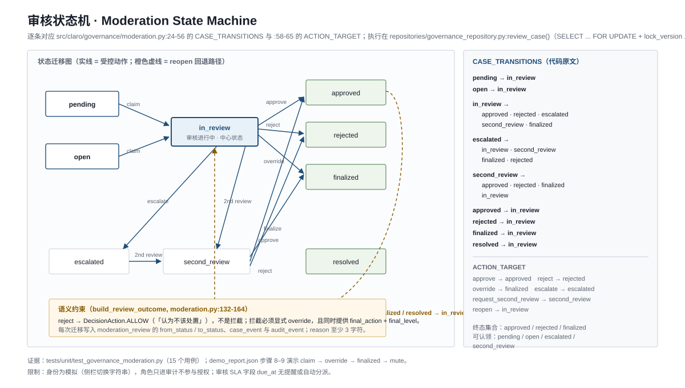

这条设计允许策略变化与人工纠正同时存在：系统决策保留原动作，人工审核追加最终动作、理由和前后状态，操作记录也以新增事件的方式保存。当前身份切换用于演示审核流程，生产环境仍需接入完整的权限体系。

### 3.4 PostgreSQL、Kafka 与 Redis 各自解决什么

| 技术 | 实际职责 | 补充说明 |
| --- | --- | --- |
| PostgreSQL | 保存业务数据，处理事务、唯一约束、JSONB、审核锁和分析查询 | 业务数据统一使用 PostgreSQL |
| Kafka | 传输原始、处理后和风险事件，支持至少一次投递、重试与死信路由 | 当前按至少一次投递设计；治理事件已发布，仓库内还没有对应业务消费者 |
| Redis | 缓存规则、策略和计数结果 | 主策略评估的频次来自 PostgreSQL 查询后缓存；Lua 限流和玩家黑名单缓存属于独立适配器 |
| Streamlit + Plotly | 提供 15 个业务页面、主题和交互图表 | 页面截图用于展示界面状态，不代替运行验证 |

### 3.5 消息处理与一致性设计

统一入口 `ClaroProcessingService.process_message()` 执行 `validate → ingest → detect → publish → governance`。它发布风险事件后，在同一进程直接调用治理服务；Kafka 消费链则由 raw、processed、risk 三个独立消费者衔接。两者共用下游业务逻辑，但不是同一条调用拓扑。

一致性依靠三层幂等：接入层 `inbox_event`、检测层 `risk_result.message_id`、治理层确定性键。消费者关闭自动提交，只在业务成功或失败路由成功后提交 offset。

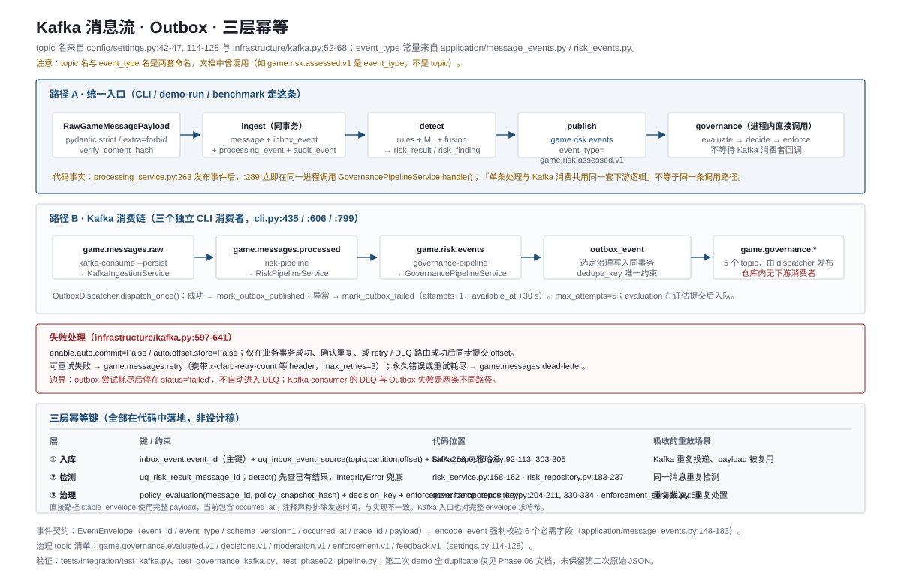

目前还需要注意：Outbox 只覆盖部分治理写入，策略评估事件会在评估提交后进入队列，重试耗尽后记录为 `failed`，没有自动死信路由。内容哈希、时间字段和追踪标识等细节见 [evidence-index.md](evidence-index.md) 的 E47–E54。

### 3.6 产品界面：让策略可操作，而不只是可查看

15 个页面分为监控、处置、策略与情报、分析、审计与配置五组。页面使用统一标题、表格、格式化、主题 token 和 45 秒纯读缓存；写操作直接走服务层。

| 用户任务 | 界面证据 | 界面支持的操作 |
| --- | --- | --- |
| 判断当前风险面 | 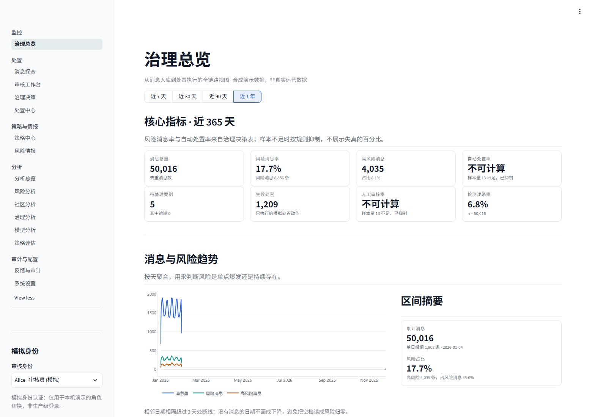 | KPI、趋势与低样本抑制在同一产品视图中 |
| 从消息追溯证据 | 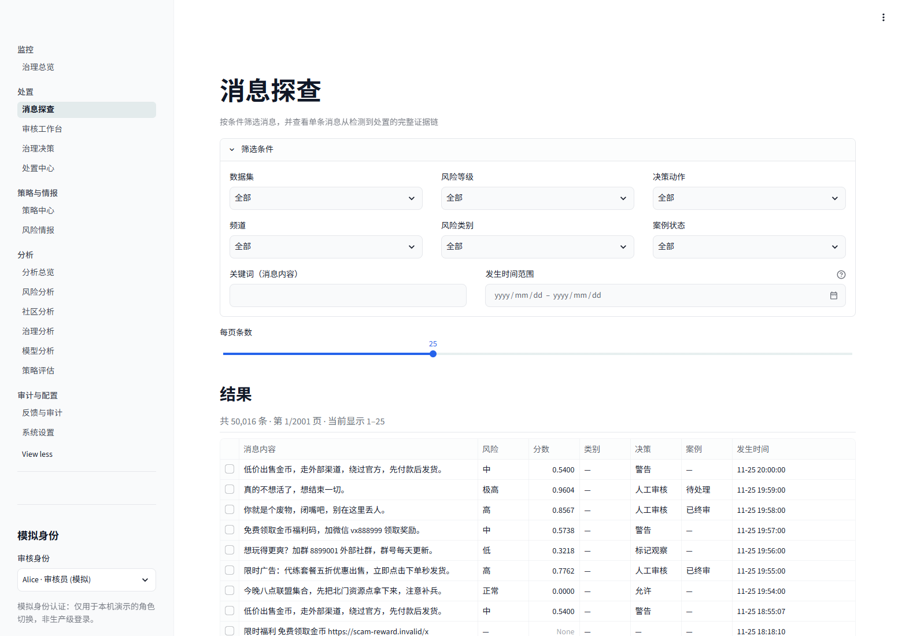 | 风险、分数、决策与案例状态可被筛选和关联 |
| 人工接管审核 | 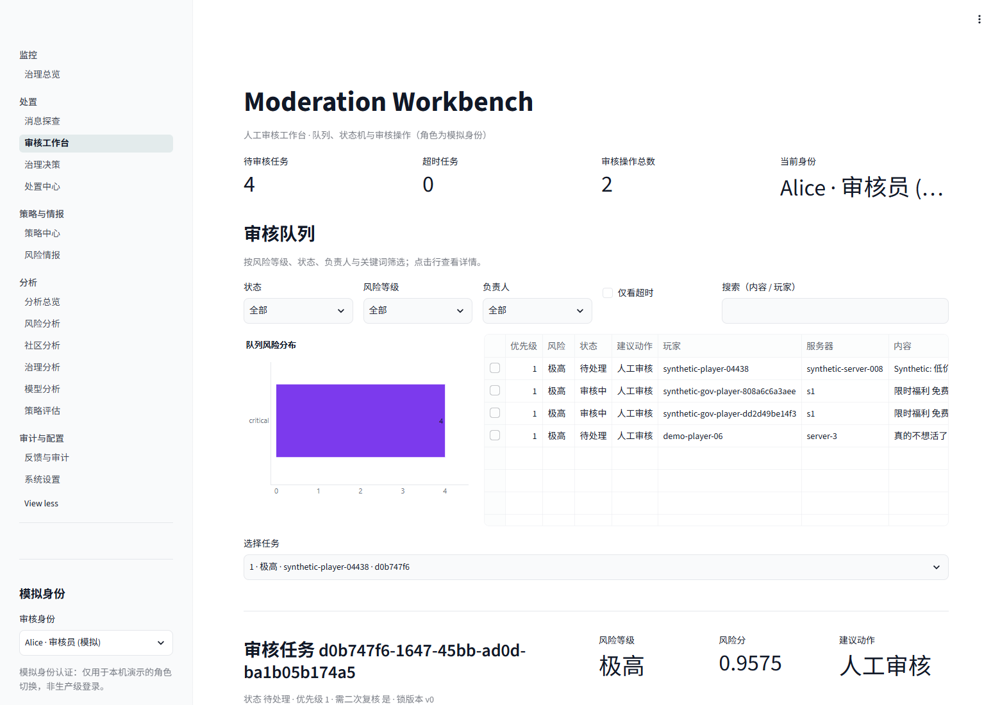 | 队列、优先级、风险证据与建议动作进入同一工作流 |
| 调整策略 | 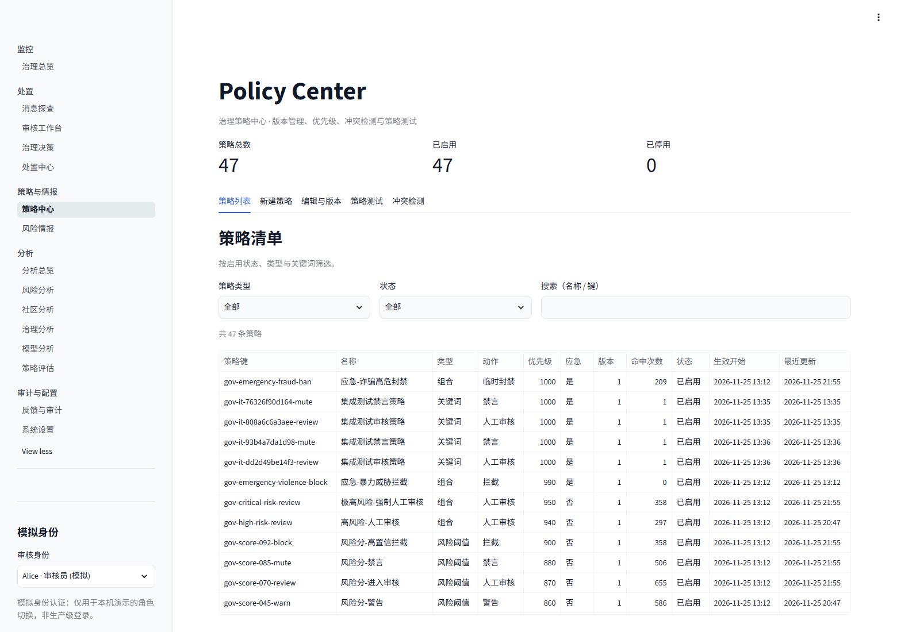 | 策略清单、版本、启停、测试与冲突检测可操作 |
| 检查处置 | 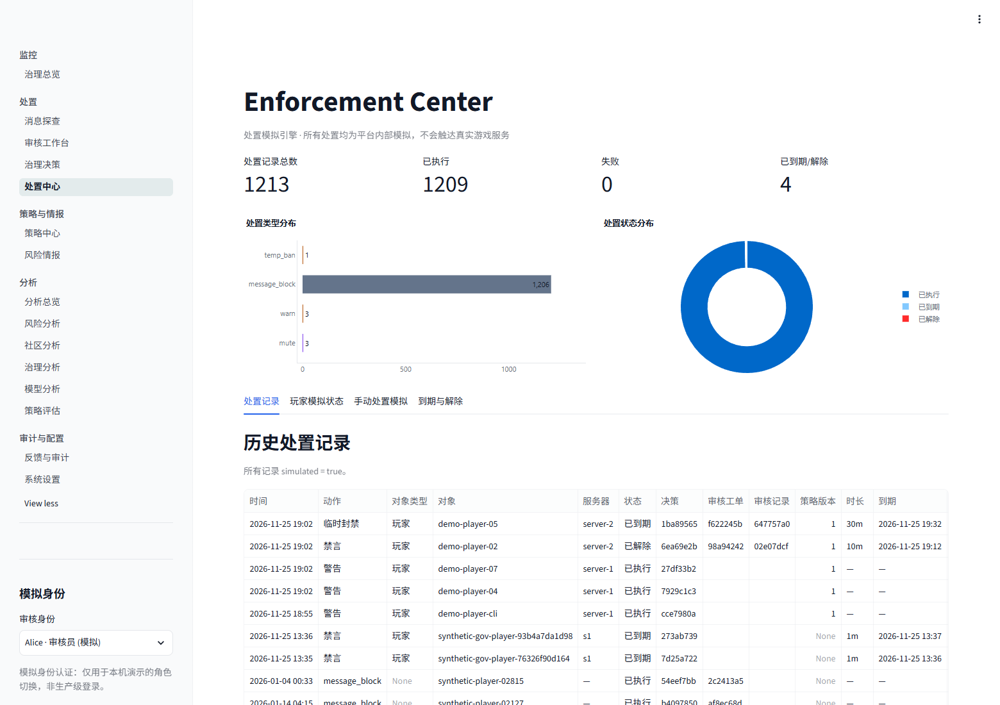 | 处置对象、时长、到期与策略引用可查询，且明确为模拟 |
| 识别检测覆盖 | 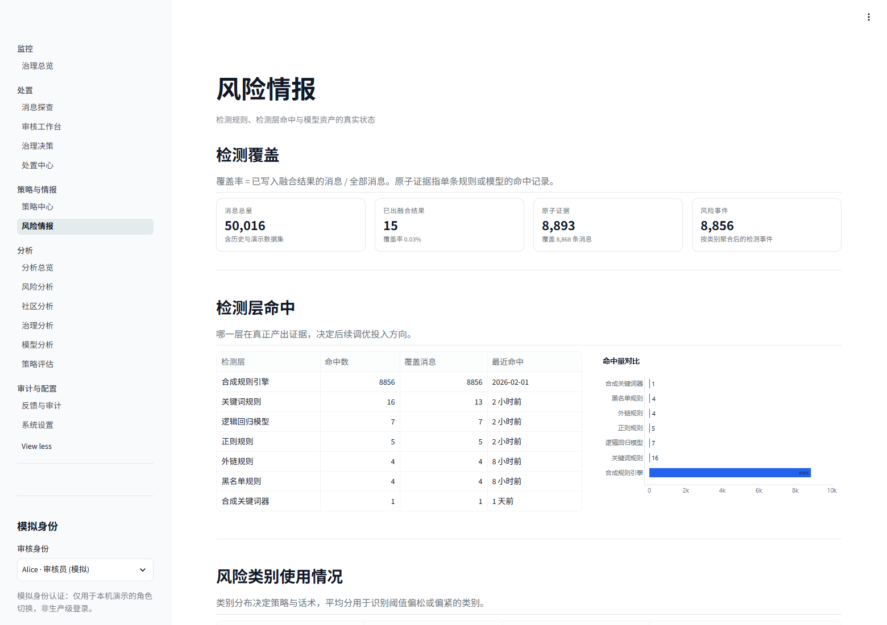 | 分别展示规则事件与完整融合结果，便于判断检测覆盖情况 |
| 检查指标口径 | 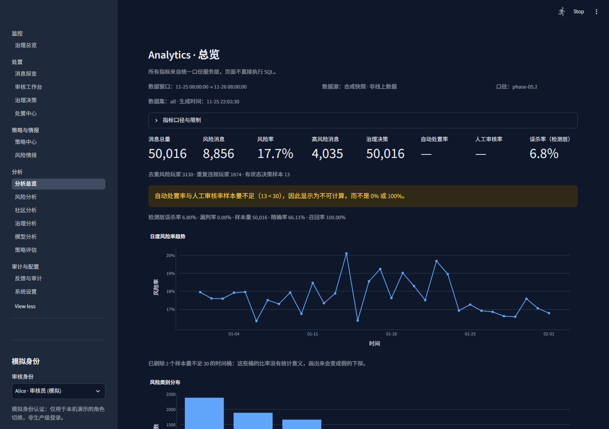 | 低样本指标显示“不可计算”，并公开 `phase-05.2` 口径 |

截图对应特定运行状态。风险情报页面显示采集时的完整融合结果为 15 条；50,016 条历史消息主要由规则事件和治理回填构成，并未全部完成完整检测与治理。

### 3.7 数据分析与数仓分支

KPI 使用 `phase-05.2` 统一定义，分母不足 30 时返回不可计算，回放样本不足 100 时标记为探索性。策略回放只写 `analytics_replay_run / case`，不执行处置、不发布事件、不改正式决策。

项目准备了 ODS/DWD/DWS/ADS 查询和 CSV 导出，用于后续数仓分析。当前环境尚未安装 Hive/Hadoop/Beeline，这部分还没有实际运行。

---

## 4. AI-assisted Development

### 4.1 如何借助 AI 分阶段完成项目

我把项目拆成多个阶段，每个阶段都先明确要解决的问题、交付内容和验收方式，再进入实现：

**需求定义 → 阶段规划 → 任务拆解 → Prompt 编写 → AI 实现 → 本地运行 → 检查反馈 → 修正 → 阶段验收**

每个阶段开始前，我会先确定业务目标、当前范围和预期结果，再把工作拆成可以独立检查的任务。交给 AI 时，我会说明相关文件、已有实现、需要修改的内容、技术限制以及需要覆盖的反例，避免它只根据一句功能描述直接生成代码。

以下字段是**根据当前交付要求整理的任务说明模板，不是保留下来的原始 Prompt**：

| 任务说明 | 我会明确的内容 |
| --- | --- |
| 要解决的问题 | 当前业务场景、期望结果和本阶段范围 |
| 输入 | 相关文件、数据、接口和已经确认的事实 |
| 输出 | 需要修改的文件、可运行行为、测试与说明 |
| 约束 | 不改变的功能、依赖限制和需要保持准确的结论 |
| 验收与反例 | 运行方式、预期结果、失败案例和需要覆盖的场景 |

AI 完成代码后，我会在本地运行项目，检查功能是否真正执行、数据结果是否符合预期、测试是否覆盖关键路径。如果结果不符合预期，我会先判断问题来自需求描述、技术方案、数据还是测试方法，再调整任务说明，让 AI 继续修改。

这个过程让我能够把主要精力放在业务分析、系统规划和结果验收上，同时利用 AI 完成大部分代码实现。

### 4.2 三个阶段中的问题发现与修正

#### Phase 04：从功能完成转向流程可追溯

Phase 04 开始时，主体治理功能已经具备。这一阶段主要完成集成检查、测试补充和缺陷修复，我重点确认：

- 策略改变是否影响真实决策；
- 人工审核是否保留原风险与最终结论；
- 模拟处置是否能追到决策、策略和审核记录。

这些检查关注业务是否真正串起来，以及关键结果能否被追踪，而不是增加了多少代码或页面。

#### Phase 05：修正指标与回放中的统计问题

验收从“页面有指标”提升到“指标是否可信、策略评估是否科学、回放是否真正隔离”。记录中的实质问题包括：

- 作用域级常量被当作真实策略计数；
- `n=1` 的比率被作为正式 KPI 展示；
- 回放样本池只取已有风险事件，排除正常消息，导致真负例缺失；
- 混淆矩阵混合命中语义与预测语义；
- 玩家档案混合不同时间窗；
- 集成测试永久修改共享演示数据。

修正后，比率有最小分母，回放纳入正常样本，不处置的策略不输出误导性的 precision / recall，隔离验证从行数比较升级为 9 张业务表的内容级 SHA-256 指纹。

这次验收让我形成了一条具体方法：**先检查指标和样本如何生成，再讨论指标高低。**

#### Phase 06：发现测试工具误报成功

测试工具的问题包括：

- UI 冒烟用例没有真正渲染目标页面；
- `-Suite all` 默认仍排除集成测试；
- 浏览器巡检把 Streamlit 的默认页回退误认为深链接成功。

这些修正让我不仅检查“AI 有没有写测试”，还会确认**测试是否真正触达目标行为、套件是否覆盖预期范围、失败是否会被工具隐藏**。

### 4.3 关于 Prompt 和开发记录

原始开发 Prompt 和完整 AI 对话没有保留，因此本文展示的是任务说明模板、阶段记录和项目成果。前文模板用于说明我如何描述需求与验收结果，不作为原始对话引用。

Phase 案例来自项目记录；我的工作方式说明和工程证据在 [evidence-index.md](evidence-index.md) 中分别标注。

---

## 5. Validation & Findings

### 5.1 如何验证项目成果

我把验证结果分成四层：

| 层级 | 能验证什么 | 验证局限 |
| --- | --- | --- |
| 代码与单元/集成测试 | 某个规则、事务或状态转移在测试条件下成立 | 真实玩家环境中的效果 |
| 本地演示与数据库记录 | 多条业务步骤实际串联并留下引用 ID | 长期稳定性与生产容量 |
| 模型评估与回放 | 特定合成样本上的指标、误差与策略差异 | 真实语料泛化或线上收益 |
| 串行性能基准 | 单机、单进程、串行条件下的延迟与写入成本 | QPS 上限、并发容量或 SLA |

### 5.2 端到端演示

保留的 `runtime/demo_report.json` 记录 7 条消息全部 `processed`，无 failed；另记录 8 组操作步骤全部成功，覆盖接入与决策、认领、覆盖系统动作、模拟禁言、临时封禁、解除、反馈和策略回放。

其中：

- 自伤信号从 `critical / 0.9604 / suggested_action=restrict` 路由到 `review / pending_review`；
- 多信号交易消息从 `medium / 0.54 / suggested_action=review` 路由到 `warn / auto_decided`；
- 人工审核把系统 `block` 覆盖为 `mute`，随后执行模拟禁言、临时封禁与解除；
- 7 条样本回放被标记为低样本，候选误杀率 `0.285714` 只具有探索意义。

这些记录说明**合成场景下业务链路可以执行并追踪**；真实运营效果还需要结合实际业务数据继续验证。

### 5.3 自动化测试与覆盖情况

最终保留日志为 **308 passed，1 warning，103.32 秒，整体语句覆盖率 79%**。阶段报告记录 240 个单元、51 个集成和 17 个 UI smoke 用例，最终日志保留了总体结果。核心处理服务 `processing_service.py` 的覆盖率为 40%，说明关键编排路径仍需补充测试。

以上是仓库保留的最近一次测试结果，本次整理未重新运行。浏览器日志中仍有连接失败记录，因此现有截图用于展示界面状态，不作为最新端到端测试通过的证明。

### 5.4 模型评估：F1 = 1.0 说明了什么

模型训练、序列化、加载、推理、评估和错误案例持久化链路真实可运行。普通测试集的二分类与多标签指标均为 1.0，但进一步检查发现：

- 玩家级隔离成立，玩家重叠为 0；
- 测试消息与训练集内容哈希重复率为 **99.47%**；
- 内容不相交子集只有 **27 条，且全部为正常样本**；
- 8 个标签阈值全部选到搜索网格最低值 `0.20`；
- 内容不相交子集的 accuracy 为 1.0，但没有风险正例，precision / recall / F1 为 0，无法估计风险泛化。

我的结论是：**模型工程链路已经验证，模型能力尚未在真实或困难样本上验证。** 1.0 主要反映合成模板的可分性，不能当作真实环境下的准确率来展示。

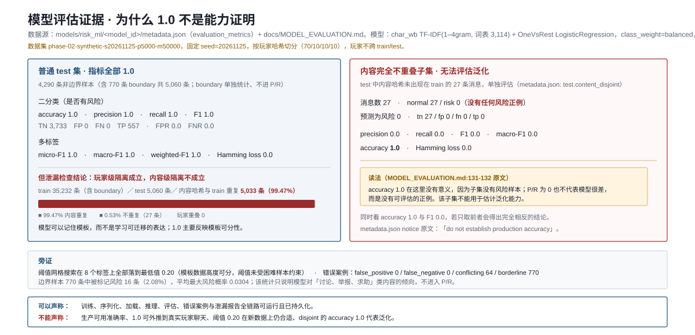

还要注意数据生成方式：合成标签由生成器按预设概率产生，批量 `risk_event` 也由同一生成器依据标签与类别生成，不是独立人工标注或独立检测结果。因此历史检测指标中的高召回、零漏判只能说明合成数据内部一致，不能证明真实漏放治理效果。

### 5.5 我会如何用数据定位策略问题

我不会先看总体命中率，而是按“类别 × 频道 × 服务器/联盟 × 风险等级 × 置信度 × 策略版本”切片，再回答四类问题：

- **误伤在哪里**：抽查误杀样本，区分关键词语境误判、白名单过宽、作用域错误和阈值过低；同一标签在不同频道可能需要不同动作。
- **漏放在哪里**：从放行样本中分层抽样，重点找变体表达、混淆字和新型骗局；只分析已报警消息无法发现漏放。
- **审核成本是否失控**：同时看送审率、重复复核、二次复核和审核积压，不能为了追求高召回把全部风险转人工。
- **置信度是否可信**：比较不同置信度区间的实际正确率；当前融合权重和门槛是手工设定，没有完成统计校准。

Claro 已提供反馈分类、逐策略指标和隔离回放，可以作为这套方法的工程基础。要形成真实运营结论，还需要补充独立标注、线上监控和审核一致性数据。

### 5.6 性能测试：本机串行结果

| 数据档位 | 样本数 | 流水线 p50 | p95 | p99 |
| --- | ---: | ---: | ---: | ---: |
| 1,000 行 | 200 | 128.2 ms | 189.32 ms | 271.54 ms |
| 10,000 行 | 200 | 107.1 ms | 149.69 ms | 179.5 ms |
| 50,000 行 | 200 | 144.51 ms | 215.5 ms | 331.59 ms |

三档共 600 条串行样本全部 `processed`。批量入库吞吐为 62.4–77.6 行/秒，走的是 `persist_raw_message()`，不是完整风险治理吞吐。无数据库 IO 的 `RiskService.analyze_text()` p50 为 5.12–7.52 ms；它不是完整 `detect()` 成本。

测量条件为 Windows 单机、full 模式、单进程串行，不含浏览器绘制、WebSocket、TLS、反向代理和并发争用；`performance_results.json` 还是多次测量合并产物，不是单次快照。**这些数字能说明本机基线，不能说明生产 QPS 或容量。**

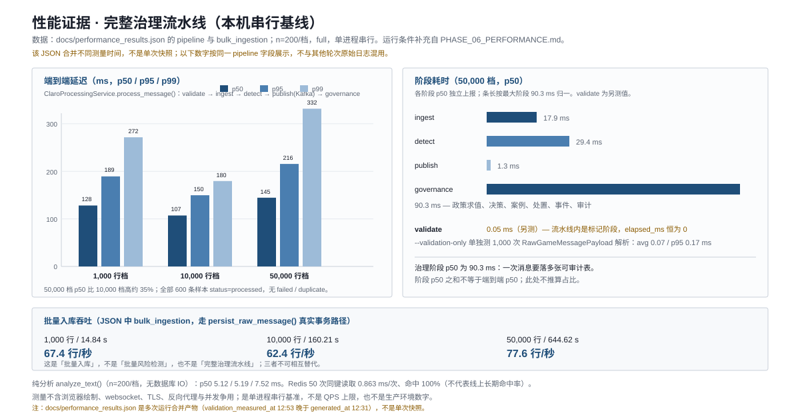

### 5.7 策略回放：命中更多不代表策略更好

500 条合成样本回放中：

| 策略 | 命中 | Precision | Recall | 审核占比 |
| --- | ---: | ---: | ---: | ---: |
| `gov-score-045-warn` | 32 | 0.406 | 0.260 | 0.000 |
| `gov-category-spam-flag` | 17 | 0.706 | 0.240 | 0.000 |
| `gov-score-070-review` | 38 | 0.974 | 0.740 | 1.000 |

更高命中量并不自动意味着更高质量；`gov-score-070-review` 的 Precision 很高，但所有命中都进入人工审核，说明质量与审核成本必须并列看。回放使用评估时刻的当前策略，不是历史时刻策略重建；限流类策略的回放计数为 0。它的价值是**同输入、不同策略的隔离比较**，不是在线上自动学习或部署。

### 5.8 数据覆盖与项目局限

历史基线包含 50,016 条消息、50,016 条治理决策和 8,856 条风险事件，但风险事件主要是批量规则/原子证据，不等同于完整融合执行。完整融合结果数量随采集时点变化为 7 / 15 / 17；有意义的核心链路证据主要来自 7 条演示消息和 600 条串行基准样本。

目前仍存在的问题包括：

- 模型内容泄漏严重，缺少真实、困难、内容不相交样本；
- 合成标签与批量风险事件同源，不能当作独立人工标注或真实漏放证据；
- Lua 原子限流适配器未接入主治理调用链，主链路的发送频次来自 PostgreSQL 查询后缓存；
- 关键编排路径覆盖率不足，UI 写路径没有完整“点击后查库”自动化；
- 5 个治理 topic 没有仓库内业务消费者，Outbox 没有自动 DLQ；
- 直接路径的哈希注释与实现不一致，重放的时间字段契约需要明确；
- `trace_id` 尚未统一覆盖所有治理记录，追溯还依赖实体关联；
- 并发、负载下 Kafka lag 与重启恢复没有系统验证；
- Hive 未执行，语义检测未实现，LLM 未做真实端点验证。

---

## 6. Reflection

### 6.1 这个项目展示了哪些能力

| 能力方向 | 项目中的体现 | 对应材料 |
| --- | --- | --- |
| 游戏内容安全策略 | 把 SLG 风险拆成标签、上下文、动作、审核与反馈，而不是只做分类 | 风险矩阵、置信度路由、策略版本与回放 |
| 游戏风控 | 理解玩家、服务器、联盟、频道和重复行为对处置的影响 | 策略作用范围、风险计数、审核与模拟处置 |
| 内容安全平台 | 设计可解释、可追溯、可人工接管的产品链路 | 消息探查、策略中心、审核工作台、处置与审计 |
| AI 应用 / 技术产品 | 人主导需求与验收，AI 承担大部分实现，并通过运行结果发现问题、推动修正 | Phase 04/05/06 的验收问题、修复与阶段门槛 |

### 6.2 我学到的最重要的事

**第一，策略质量不能只靠命中量衡量。** 误杀、漏判和审核成本需要一起评估，否则页面会奖励“处置更多”而不是“治理更好”。

**第二，可解释性来自保留过程，不只是给一个分数。** 规则片段、模型概率、层间冲突、策略快照和人工最终动作需要分别保存。

**第三，AI 加速的是实现，不替代验收。** 代码存在不等于功能执行，测试通过不等于测试有效，指标很高不等于样本可信。我的价值在于定义验收口径，并识别这些差距。

**第四，清楚说明项目阶段比堆叠功能更重要。** 记录已经完成的能力和后续方向，才能判断下一步应该投入什么。

### 6.3 如果继续推进，我会优先做什么

1. **补齐业务载体**：先定义邮件、公告和昵称的独立数据模型与审批流程，不继续用频道字符串代替实体。
2. **重建模型评估集**：引入内容不相交、困难负例、变体表达和真实标注口径，再讨论模型阈值与泛化。
3. **提高关键链路覆盖**：优先补统一编排、部分发布失败、审核写路径和 Kafka 重启恢复测试。
4. **完善事件闭环**：为治理 topic 接入真实消费者，明确 Outbox 耗尽后的人工恢复或 DLQ 设计。
5. **保留 AI 协作记录**：后续阶段保存需求版本、Prompt、验收清单和运行日志，便于复盘项目推进过程。
6. **验证或移除非核心依赖**：安装原生 Hive 环境后实际执行数仓；否则明确标记为暂不可用，不用 SQL 文件代替运行结果。

### 6.4 相关材料

- [项目中文说明](https://github.com/ipengfei1994/Claro/blob/main/README.zh-CN.md)
- [英文说明](https://github.com/ipengfei1994/Claro/blob/main/README.md)
- [Phase 06 交付记录](https://github.com/ipengfei1994/Claro/blob/main/docs/PHASE_06_COMPLETION_REPORT.md)
- [模型评估报告](https://github.com/ipengfei1994/Claro/blob/main/docs/MODEL_EVALUATION.md)
- [性能与容量报告](https://github.com/ipengfei1994/Claro/blob/main/docs/PHASE_06_PERFORMANCE.md)
- [关键论点证据索引](evidence-index.md)

Claro 是一个由我主导业务设计与开发推进、借助 AI 完成大部分代码实现的个人项目。它展示了如何把游戏内容安全需求转化为可运行、可验证的平台原型，也为后续进入真实业务明确了需要继续验证的问题。
